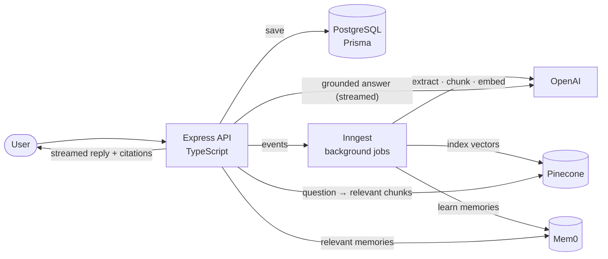
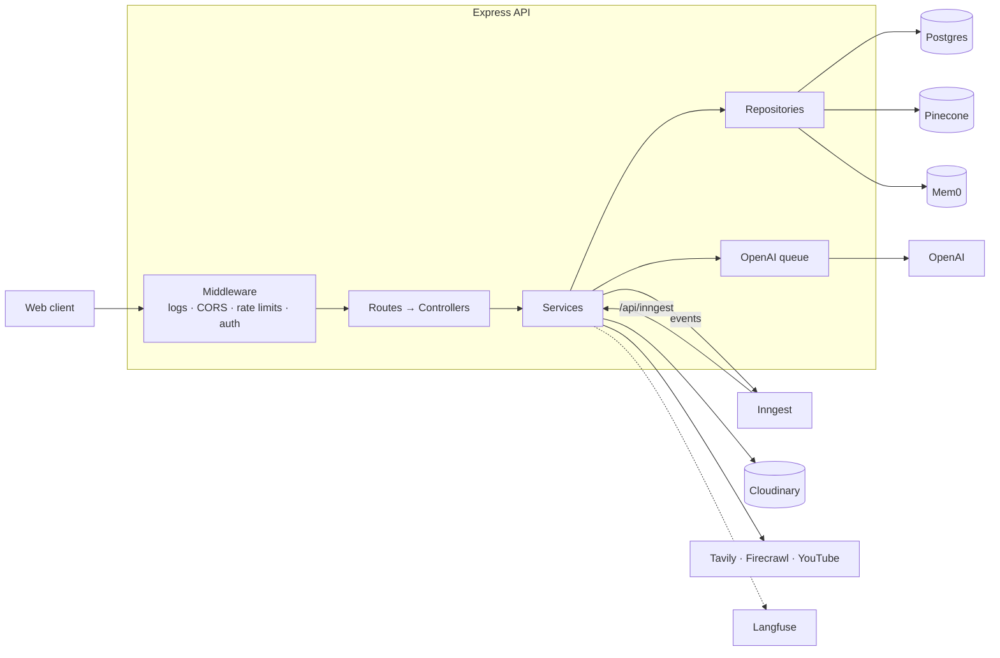

# Grounded Brain Notebook LLM

**A NotebookLM-style backend.** Upload PDFs, websites, YouTube videos and notes into a workspace,
chat with them and get answers **grounded in your own sources with citations**, and turn them into
summaries, flashcards, quizzes, mind maps and reports. It also remembers what it learns about you.

> **Frontend:** the web client lives in a separate repository: _coming soon_.
> <!-- TODO: replace with the frontend repo link once it is published -->

---

## Contents

- [What it does](#what-it-does)
- [How it works](#how-it-works)
- [Tech stack](#tech-stack)
- [Architecture](#architecture)
- [Getting started](#getting-started)
- [Scripts](#scripts)
- [Project structure](#project-structure)
- [API at a glance](#api-at-a-glance)
- [Testing](#testing)
- [Deployment](#deployment)
- [Documentation](#documentation)

---

## What it does

| Feature                 | Description                                                                                                                                                                                                                                           |
| ----------------------- | ----------------------------------------------------------------------------------------------------------------------------------------------------------------------------------------------------------------------------------------------------- |
| **Workspaces**          | Separate notebooks, each with its own sources, chats and study material. Pick a default model per workspace.                                                                                                                                          |
| **Sources**             | Add **PDFs** (uploaded and security-checked), **websites** (scraped to markdown), **YouTube videos** (transcripts), **plain text / markdown**, and **web search results**. Each source is extracted, chunked, embedded and indexed in the background. |
| **Grounded chat (RAG)** | Ask questions; the answer streams back using only the relevant passages from your sources, with inline citations like `[1]` (with page numbers for PDFs). Follow-up questions are understood in context.                                              |
| **Web search**          | Optionally let the model search the web (Tavily); web results are cited as `[W1]` and can be saved as sources.                                                                                                                                        |
| **Long conversations**  | Older turns are condensed into a rolling summary in the background, so long chats stay coherent and affordable.                                                                                                                                       |
| **Memory**              | The app learns durable facts about you from chats (Mem0), such as preferences or what you're studying, and uses them in later answers. You can also add, edit and delete memories yourself.                                                           |
| **Learning artifacts**  | Generate a **summary**, **key takeaways**, **flashcards**, a **quiz**, a **mind map** or a long-form **report** from all or selected sources.                                                                                                         |
| **Production basics**   | Cookie auth with Google OAuth, per-user isolation, rate limiting, validated config, structured logs, LLM tracing, health and readiness checks, graceful shutdown.                                                                                     |

---

## How it works



1. **Add a source.** The API stores it and fires an event. An **Inngest** job extracts the text,
   splits it into ~1000-character chunks with **LangChain**'s text splitter, embeds each chunk with
   **OpenAI**, and stores the vectors in **Pinecone** (one namespace per workspace).
2. **Ask a question.** The API rewrites follow-ups into a standalone query, finds the most similar
   chunks in Pinecone and relevant memories in **Mem0**, and asks the model to answer **only from
   those chunks** and cite them. The answer streams back through the **Vercel AI SDK**.
3. **In the background,** long conversations are summarised and new facts about the user are
   saved to Mem0; artifacts (quizzes, flashcards, ...) are generated as structured, validated JSON.

---

## Tech stack

| Area                     | Tool                                                                                                               | Used for                                                                    |
| ------------------------ | ------------------------------------------------------------------------------------------------------------------ | --------------------------------------------------------------------------- |
| **Language**             | [TypeScript](https://www.typescriptlang.org/) on [Node.js](https://nodejs.org/) 24 (ES modules)                    | The whole codebase                                                          |
| **Web framework**        | [Express 5](https://expressjs.com/)                                                                                | HTTP API, middleware, routing                                               |
| **Database**             | [PostgreSQL 16](https://www.postgresql.org/)                                                                       | Users, workspaces, sources, chunks, chats, artifacts                        |
| **ORM**                  | [Prisma 7](https://www.prisma.io/) + `@prisma/adapter-pg`                                                          | Typed queries, schema, migrations                                           |
| **Local infrastructure** | [Docker Compose](https://docs.docker.com/compose/)                                                                 | Runs Postgres locally with one command                                      |
| **Auth**                 | [Better Auth](https://www.better-auth.com/)                                                                        | Cookie sessions, Google OAuth, email/password (dev only)                    |
| **Validation**           | [Zod 4](https://zod.dev/)                                                                                          | Request bodies/params/queries, environment variables, LLM structured output |
| **LLM**                  | [OpenAI](https://platform.openai.com/) (`gpt-4o-mini`, `gpt-4o`)                                                   | Chat answers, query rewriting, artifacts, summaries                         |
| **Embeddings**           | OpenAI `text-embedding-3-small` (1536 dims)                                                                        | Vectors for semantic search                                                 |
| **AI toolkit**           | [Vercel AI SDK](https://ai-sdk.dev/) (`ai`, `@ai-sdk/openai`)                                                      | Streaming chat, tool calling (web search), structured generation            |
| **Text splitting**       | [LangChain text splitters](https://js.langchain.com/)                                                              | Recursive chunking on paragraph/sentence boundaries                         |
| **Tokenizer**            | [js-tiktoken](https://github.com/dqbd/tiktoken)                                                                    | Token counts per chunk                                                      |
| **Vector database**      | [Pinecone](https://www.pinecone.io/)                                                                               | Similarity search over chunks (namespace per workspace)                     |
| **Long-term memory**     | [Mem0](https://mem0.ai/)                                                                                           | Learning and recalling facts about each user                                |
| **Background jobs**      | [Inngest](https://www.inngest.com/)                                                                                | Durable, retried, cancellable jobs (indexing, generation, summaries)        |
| **Web search**           | [Tavily](https://tavily.com/)                                                                                      | Chat `web_search` tool                                                      |
| **Web scraping**         | [Firecrawl](https://www.firecrawl.dev/)                                                                            | Website → clean markdown                                                    |
| **File storage**         | [Cloudinary](https://cloudinary.com/)                                                                              | Uploaded PDFs                                                               |
| **PDF parsing**          | [unpdf](https://github.com/unjs/unpdf) (pdf.js)                                                                    | Text per page; active-content checks                                        |
| **YouTube**              | [youtube-transcript](https://www.npmjs.com/package/youtube-transcript)                                             | Video transcripts                                                           |
| **File uploads**         | [multer](https://github.com/expressjs/multer), sanitize-filename                                                   | Multipart PDF uploads with limits                                           |
| **Rate limiting**        | [express-rate-limit](https://express-rate-limit.mintlify.app/), [p-queue](https://github.com/sindresorhus/p-queue) | Inbound limits per IP/user; outbound OpenAI throttling                      |
| **Logging**              | [pino](https://getpino.io/), pino-http, pino-pretty                                                                | Structured JSON logs with request ids                                       |
| **LLM observability**    | [Langfuse](https://langfuse.com/) + OpenTelemetry                                                                  | Traces of every prompt, response, token count and latency                   |
| **Linting**              | [ESLint 10](https://eslint.org/) + typescript-eslint (type-aware)                                                  | Static analysis                                                             |
| **Formatting**           | [Prettier](https://prettier.io/)                                                                                   | Consistent code style                                                       |
| **Dev tooling**          | tsx (watch mode), concurrently, dotenv, Prisma Studio                                                              | Local development                                                           |
| **API testing**          | Postman collection, end-to-end smoke test script                                                                   | Feature checks against a running server                                     |

Why each tool was chosen, and what it does in this codebase: [Architecture → Every tool](docs/ARCHITECTURE.md#3-every-tool-and-why-it-is-here).

---

## Architecture



- **Layered:** routes → controllers (validate with Zod) → services (business rules, ownership
  checks) → repositories (the only code that touches Postgres, Pinecone or Mem0).
- **Async by default:** slow work runs in Inngest jobs; requests return immediately and the client polls status.
- **Safe AI calls:** one shared queue for every OpenAI request, untrusted source text kept out of the system prompt.

**Read the full technical walkthrough in [docs/ARCHITECTURE.md](docs/ARCHITECTURE.md):** request
lifecycle, every feature's data flow (with sequence diagrams), background jobs, the AI layer,
errors, rate limits, logging, configuration and deployment.
Icon diagrams (Eraser) are in [docs/diagrams](docs/diagrams/README.md).

---

## Getting started

### Prerequisites

- **Node.js 24+** and npm
- **Docker** (for the local Postgres)
- API keys:

| Service                                        | Required                                    | Needed for                                         |
| ---------------------------------------------- | ------------------------------------------- | -------------------------------------------------- |
| [OpenAI](https://platform.openai.com/api-keys) | **yes**                                     | Chat, embeddings, artifacts                        |
| [Pinecone](https://app.pinecone.io/)           | **yes**                                     | Vector search (the index is created automatically) |
| [Inngest](https://www.inngest.com/)            | no locally (dev server) / yes in production | Background jobs                                    |
| [Cloudinary](https://cloudinary.com/)          | optional                                    | PDF uploads (unsigned upload preset)               |
| [Firecrawl](https://www.firecrawl.dev/)        | optional                                    | Website imports                                    |
| [Tavily](https://tavily.com/)                  | optional                                    | Web search in chat                                 |
| [Mem0](https://app.mem0.ai/)                   | optional                                    | Memories                                           |
| [Langfuse](https://langfuse.com/)              | optional                                    | LLM tracing                                        |
| Google OAuth client                            | optional locally / yes in production        | Google sign-in                                     |

Optional integrations degrade gracefully: their endpoints return `503` and everything else works.

### Setup

```bash
git clone https://github.com/mohammedsaif001/grounded-brain-notebook-llm.git
cd grounded-brain-notebook-llm
npm install
cp .env.example .env
```

Fill in `.env`: at minimum `BETTER_AUTH_SECRET` (any long random string), `OPENAI_API_KEY` and
`PINECONE_API_KEY`. `DATABASE_URL` already matches the Docker Postgres. Every variable is
explained in [`.env.example`](.env.example) and [Architecture → Configuration](docs/ARCHITECTURE.md#14-configuration).
The server validates the environment on boot and lists anything missing.

### Run

```bash
npm run dev
```

This one command:

1. starts Postgres in Docker (`localhost:5434`) and waits until it's healthy,
2. applies database migrations and generates the Prisma client,
3. runs together:
    - the **API** with hot reload on **http://localhost:8080**,
    - the **Inngest dev server** on **http://localhost:8288** (dashboard for every job run),
    - **Prisma Studio** on **http://localhost:5555** (browse the database).

Check it: `curl http://localhost:8080/health/ready`.

---

## Scripts

| Command                             | What it does                                                 |
| ----------------------------------- | ------------------------------------------------------------ |
| `npm run dev`                       | Everything for local development (see above)                 |
| `npm run dev:api`                   | Only the API, with hot reload                                |
| `npm run dev:inngest`               | Only the Inngest dev server                                  |
| `npm run build`                     | Generate the Prisma client and compile TypeScript to `dist/` |
| `npm start`                         | Run the compiled server (`dist/server.js`)                   |
| `npm run docker:up` / `docker:down` | Start / stop the local Postgres                              |
| `npm run docker:reset`              | Wipe the local database and re-apply migrations              |
| `npm run db:migrate`                | Create and apply a migration (development)                   |
| `npm run db:migrate:deploy`         | Apply pending migrations (CI / production)                   |
| `npm run db:generate`               | Regenerate the Prisma client                                 |
| `npm run db:studio`                 | Open Prisma Studio                                           |
| `npm run typecheck`                 | TypeScript check (app + scripts)                             |
| `npm run lint` / `lint:fix`         | ESLint                                                       |
| `npm run format` / `format:check`   | Prettier                                                     |
| `npm run check`                     | Typecheck + lint + format check                              |
| `npm run smoke`                     | End-to-end smoke test against a running server               |

---

## Project structure

```
src/
├── server.ts          # entry point: telemetry, listen, graceful shutdown
├── app.ts             # Express app and middleware order
├── routes.ts          # mounts feature routers
├── config/            # validated env, clients (OpenAI, Pinecone, Mem0, ...), prompts, AI constants
├── jobs/              # Inngest events and background functions
├── shared/            # HTTP helpers, middleware, embeddings, vector repository
└── features/
    ├── workspace/     # notebooks + ownership checks
    ├── source/        # sources + ingestion (PDF, website, YouTube, chunking)
    ├── chat/          # RAG chat, retrieval, prompts, web search
    ├── conversation/  # threads, messages, rolling summaries
    ├── artifact/      # summaries, flashcards, quizzes, mind maps, reports
    ├── memory/        # Mem0 memories
    └── health/        # liveness and readiness
prisma/                # schema (one file per model) and migrations
scripts/               # smoke test
docs/                  # architecture, database, API, diagrams
```

Each feature has the same files: `*.routes.ts`, `*.controller.ts`, `*.validator.ts`,
`*.service.ts`, `*.repository.ts`. Every function is documented with JSDoc.

---

## API at a glance

| Feature       | Base path                           | Highlights                                                                                       |
| ------------- | ----------------------------------- | ------------------------------------------------------------------------------------------------ |
| Health        | `/health`, `/health/ready`          | Liveness; readiness of every dependency                                                          |
| Auth          | `/api/auth/*`, `/api/me`            | Better Auth sign-up/sign-in/sign-out, Google OAuth                                               |
| Workspaces    | `/api/workspaces`                   | CRUD                                                                                             |
| Sources       | `/api/workspaces/:id/sources`       | Text/markdown, PDF upload, website, YouTube, web results; list/filter, chunks, reprocess, delete |
| Chat          | `/api/workspaces/:id/chat`          | Streamed, cited answers; optional web search                                                     |
| Conversations | `/api/workspaces/:id/conversations` | List, create, message history with citations, delete                                             |
| Artifacts     | `/api/workspaces/:id/artifacts`     | Generate and fetch study material                                                                |
| Memory        | `/api/memory`                       | List, add, edit, delete memories                                                                 |

Every JSON response uses the envelope `{ success, data }` or `{ success, error: { code, message, details } }`.

**Full endpoint reference with request/response examples: [docs/API.md](docs/API.md).**
Import [`grounded-brain.postman_collection.json`](grounded-brain.postman_collection.json) into
Postman to try every endpoint; running the whole collection signs up a test user and exercises every feature.

---

## Testing

- **Postman:** run the collection in the Collection Runner. Every request has tests, including
  negative cases (400/401/404) and cross-user isolation checks. See [docs/API.md](docs/API.md#using-the-postman-collection).
- **Smoke test:** `npm run smoke` runs the whole API end to end against a running server
  (`--no-ai` skips OpenAI calls, `--external` adds PDF/website/YouTube/web search). See [docs/SMOKE_TEST.md](docs/SMOKE_TEST.md).
- **Static checks:** `npm run check`.

---

## Deployment

The API deploys as a standard Node service:

```bash
npm ci && npm run build
npm run db:migrate:deploy
npm start
```

In production: set `NODE_ENV=production` (email/password login turns off, so configure Google
OAuth), use a managed Postgres, set the Inngest Cloud keys and register `https://<host>/api/inngest`,
set `TRUST_PROXY_HOPS` behind a proxy, and point health checks at `/health` and `/health/ready`.
Full checklist: [Architecture → Deployment](docs/ARCHITECTURE.md#16-deployment).

---

## Documentation

| Document                                     | What's inside                                                                                                                                                                                                |
| -------------------------------------------- | ------------------------------------------------------------------------------------------------------------------------------------------------------------------------------------------------------------ |
| [docs/ARCHITECTURE.md](docs/ARCHITECTURE.md) | Technical deep dive: every tool and why, layers, request lifecycle, data flow per feature, background jobs, AI layer, errors, rate limits, logging, config, Docker, deployment, function reference, glossary |
| [docs/DATABASE.md](docs/DATABASE.md)         | ER diagram, every table and column, relations and cascades, indexes, enums and lifecycles, JSON shapes, Pinecone/Mem0 data, `@@map` names, migrations                                                        |
| [docs/API.md](docs/API.md)                   | Postman collection guide and every endpoint with examples and expected errors                                                                                                                                |
| [docs/SMOKE_TEST.md](docs/SMOKE_TEST.md)     | Running the end-to-end smoke test                                                                                                                                                                            |
| [docs/diagrams/](docs/diagrams/README.md)    | Eraser diagram-as-code files with icons                                                                                                                                                                      |
