# Architecture

A technical walkthrough of the Grounded Brain backend: what each part does, how data moves
between them, and why things are built the way they are. Read the [README](../README.md) first
for the overview; this document goes one level deeper.

Related docs: [Database](DATABASE.md) · [API guide](API.md) · [Smoke test](SMOKE_TEST.md) · [Diagrams](diagrams/README.md)

---

## Contents

1. [Mental model](#1-mental-model)
2. [System architecture](#2-system-architecture)
    - [2.1 GenAI Core Architecture: OpenAI · Mem0 · Vector Database (Qdrant & Pinecone)](#21-genai-core-architecture-openai--mem0--vector-database-qdrant--pinecone)
3. [Every tool, and why it is here](#3-every-tool-and-why-it-is-here)
4. [Project structure](#4-project-structure)
5. [Layered design: routes → controllers → services → repositories](#5-layered-design)
6. [Life of an HTTP request](#6-life-of-an-http-request)
7. [Authentication](#7-authentication)
8. [Feature deep dives](#8-feature-deep-dives)
    - [8.1 Workspaces](#81-workspaces)
    - [8.2 Sources and the ingestion pipeline](#82-sources-and-the-ingestion-pipeline)
    - [8.3 Chat (RAG)](#83-chat-rag)
    - [8.4 Conversations, rolling summaries and learned memories](#84-conversations-rolling-summaries-and-learned-memories)
    - [8.5 Memory (Mem0)](#85-memory-mem0)
    - [8.6 Learning artifacts](#86-learning-artifacts)
    - [8.7 Health checks](#87-health-checks)
9. [Background jobs (Inngest)](#9-background-jobs-inngest)
10. [The AI layer](#10-the-ai-layer)
11. [Errors and the response envelope](#11-errors-and-the-response-envelope)
12. [Rate limiting](#12-rate-limiting)
13. [Logging and observability](#13-logging-and-observability)
14. [Configuration](#14-configuration)
15. [Local development and Docker](#15-local-development-and-docker)
16. [Deployment](#16-deployment)
17. [Function reference](#17-function-reference)
18. [Glossary](#18-glossary)

---

## 1. Mental model

Grounded Brain is a NotebookLM-style backend. A user:

1. creates a **workspace** (a notebook),
2. adds **sources** to it (PDFs, websites, YouTube videos, notes),
3. **chats** with those sources and gets answers with citations like `[1]`,
4. generates **learning artifacts** (summary, flashcards, quiz, mind map, ...),
5. and the app remembers useful facts about them as **memories**.

Everything heavy (extracting text, embedding, generating artifacts, summarising long chats)
runs in **background jobs**, so HTTP requests stay fast. The one exception is chat, which
streams the answer back token by token.

Three kinds of storage work together:

| Store        | Role                                                                      |
| ------------ | ------------------------------------------------------------------------- |
| **Postgres** | The source of truth: users, workspaces, sources, chunks, chats, artifacts |
| **Pinecone** | Vector index: "which chunks are semantically closest to this question?"   |
| **Mem0**     | Long-term memory about each user, across all workspaces                   |

---

## 2. System architecture

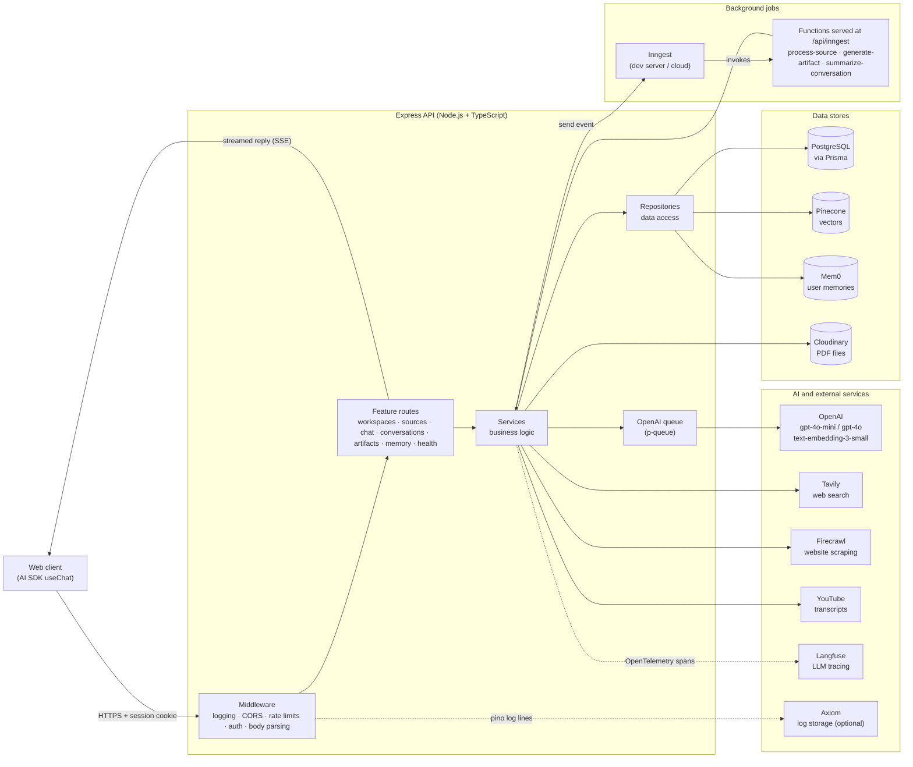

<details>
<summary>Diagram not rendering (e.g. in the GitHub mobile app)? View it as an image</summary>

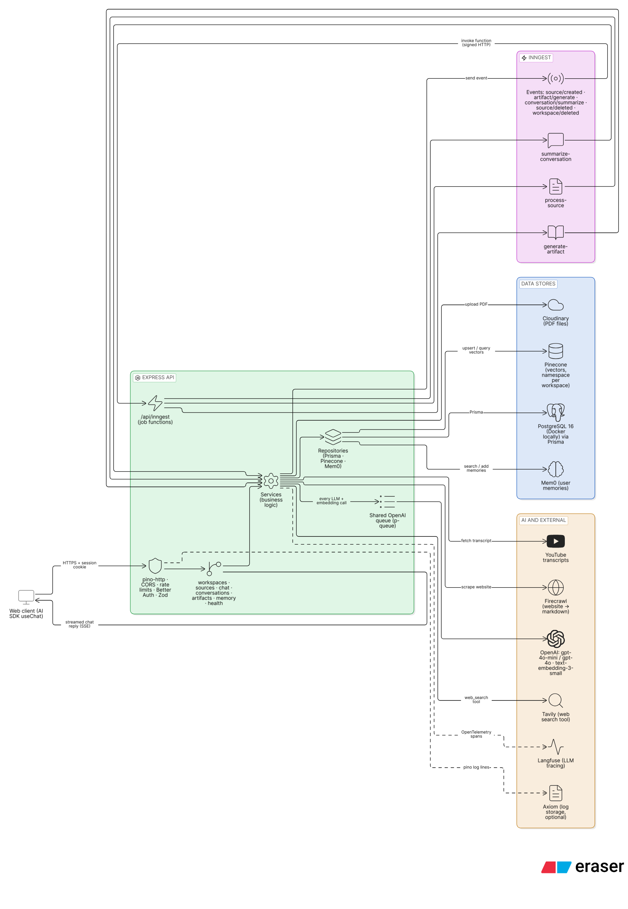

</details>

> An icon version (OpenAI, Postgres, Pinecone, Docker, Inngest logos) is in
> [`diagrams/architecture.eraser`](diagrams/architecture.eraser). See [diagrams/README.md](diagrams/README.md)
> for how to render it.

**Who calls whom:**

- The **client** only talks to the Express API.
- The **API** writes to Postgres, then sends an **event** to Inngest (for example `source/created`).
- **Inngest** calls back into the same Express app at `/api/inngest` to run the job. The job
  code is ordinary service code (`SourceProcessingService`, `ArtifactService`, ...).
- Every **OpenAI** call (chat, generation, query rewriting, embeddings) goes through one shared
  queue so the app never exceeds its OpenAI rate limits.
- **Langfuse** receives traces of every AI SDK call (prompts, outputs, tokens, latency).

---

### 2.1 GenAI Core Architecture: OpenAI · Mem0 · Vector Database (Qdrant & Pinecone)

This project is at its heart a **grounded generative AI platform**. Below is the dedicated architecture diagram mapping out the **GenAI Core**—illustrating precisely where and how **OpenAI**, **Mem0**, and the **Vector Database (Qdrant / Pinecone)** interact across every user action and background job.

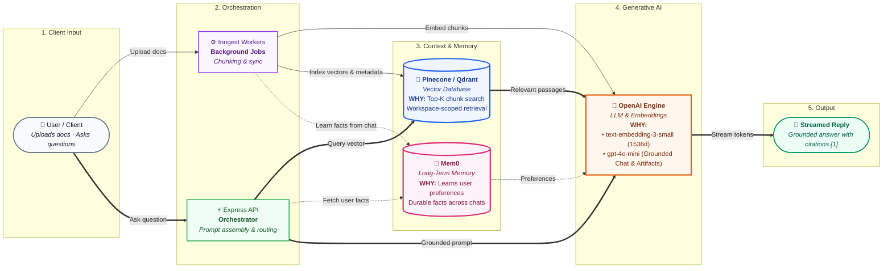

<details>
<summary>Diagram not rendering (e.g. in the GitHub mobile app)? View it as an image</summary>

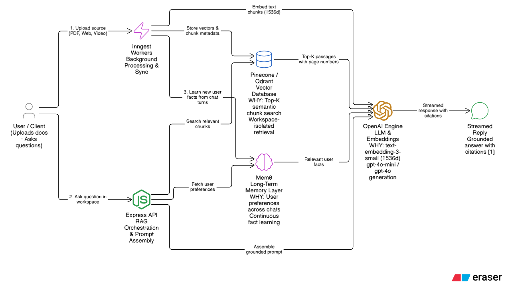

</details>

> An icon version (OpenAI, Mem0, Qdrant/Pinecone, Inngest, Express, PostgreSQL) is available in
> [`diagrams/genai-core-architecture.eraser`](diagrams/genai-core-architecture.eraser). See [diagrams/README.md](diagrams/README.md) for rendering details.

#### The 3 Core Pillars of the GenAI Layer

| Pillar                           | Technology                                                     | Role in Grounded Brain                                                                                                                                                                                                                                                             | Key Parameters & Gotchas                                                                                                                                                                                                                                                                                                                 |
| :------------------------------- | :------------------------------------------------------------- | :--------------------------------------------------------------------------------------------------------------------------------------------------------------------------------------------------------------------------------------------------------------------------------- | :--------------------------------------------------------------------------------------------------------------------------------------------------------------------------------------------------------------------------------------------------------------------------------------------------------------------------------------- |
| **🤖 Intelligence & Embeddings** | **OpenAI** (`gpt-4o-mini`, `gpt-4o`, `text-embedding-3-small`) | Powers **RAG chat streaming** (SSE), **contextual query rewriting**, **rolling conversation summarization**, **structured artifact generation** (Zod schemas), and **1536-dim chunk vectorization**.                                                                               | All calls pass through a centralized `p-queue` (max 4 concurrent, 300 RPM, max queue 100) to protect against rate limits. Untrusted source text is placed strictly in user turns inside delimited `<sources>` blocks, never in system instructions.                                                                                      |
| **🧠 Long-Term Memory**          | **Mem0** (`mem0ai` SDK)                                        | Acts as the **cognitive memory layer** for personalized AI. Unlike raw vector storage, Mem0 extracts distilled atomic facts from chat turns, automatically resolves contradictions (e.g. updating stale user facts), and maintains an adaptive user profile across all workspaces. | Extracted asynchronously during rolling summarization runs (`infer: true`). Injected into chat system prompts when semantic relevance score `≥ 0.3` (up to top 5 memories). Fails gracefully if `MEM0_API_KEY` is not configured.                                                                                                        |
| **🎯 Vector Database**           | **Vector Engine: Qdrant & Pinecone**                           | Stores 1536-dimensional chunk vectors with rich metadata payloads (`workspaceId`, `sourceId`, `chunkId`, `page`, `sourceTitle`, `text`). Performs **Approximate Nearest Neighbor (ANN)** cosine similarity search for RAG grounding.                                               | **Namespace / Payload Filtering**: Search is strictly scoped by `workspaceId` so queries never bleed across notebooks. Pinecone is integrated serverless in the codebase; Qdrant provides high-speed HNSW indexing and native JSON payload filtering (ideal for self-hosted or cloud deployments and as Mem0's underlying vector store). |

#### The 4 Core GenAI Execution Loops

1. **Source Ingestion & Vectorization Loop**:
    - Documents (PDFs, URLs, YouTube videos, markdown notes) are parsed into text.
    - Text is split into ~1,000-character segments (~200 char overlap) using LangChain's `RecursiveCharacterTextSplitter`.
    - Each chunk is embedded via OpenAI's `text-embedding-3-small` (1536 dimensions) via `scheduleOpenAI`.
    - Vectors and their metadata payloads (`workspaceId`, `sourceId`, `chunkId`, `chunkIndex`, `page`, `text`) are upserted into the Vector Database (Pinecone / Qdrant), while raw chunks and token counts are stored in PostgreSQL.

2. **Grounded RAG Retrieval & Streaming Generation Loop**:
    - The user asks a question in a workspace conversation.
    - `RetrievalService` calls OpenAI (`gpt-4o-mini`) to rewrite follow-up questions into standalone queries based on chat history.
    - The standalone query is embedded and sent to the Vector Database to fetch the Top-K most similar chunks (filtered strictly by `workspaceId`).
    - Simultaneously, `MemoryService` queries Mem0 for the user's top personalized facts (filtered by score `≥ 0.3`).
    - `ChatService` constructs a prompt with escaped `<sources>` and `<memories>` blocks.
    - OpenAI (`gpt-4o-mini` or `gpt-4o`) streams the answer back to the client using Vercel AI SDK (`streamText`) with mandatory citations (`[1]` for document page references, `[W1]` for optional Tavily web search).

3. **Continuous Agent Memory Learning & Summarization Loop**:
    - Every 8 chat messages, Inngest triggers the `summarize-conversation` background job.
    - OpenAI (`gpt-4o-mini`) condenses the previous summary plus only the new message turns into an updated rolling summary, keeping long conversations fast and affordable.
    - Concurrently, the new messages are dispatched to Mem0 with `infer: true`. Mem0's LLM extracts durable user facts, updates conflicting preferences, and writes them to the user's long-term memory store.

4. **Structured Learning Artifact Synthesis Loop**:
    - When a user requests a Summary, Flashcards, Quiz, Mind Map, or Deep-Dive Report, Inngest runs `generate-artifact`.
    - Chunks from the selected sources are loaded from PostgreSQL (or condensed if exceeding token limits).
    - OpenAI (`gpt-4o-mini`) is invoked with Vercel AI SDK's `generateText` and `Output.object({ schema })`.
    - The resulting payload is validated against strict Zod schemas and saved to PostgreSQL as typed JSON ready for UI rendering.

---

## 3. Every tool, and why it is here

### Runtime and language

| Tool                         | What it is               | Why we use it                                                                                        |
| ---------------------------- | ------------------------ | ---------------------------------------------------------------------------------------------------- |
| **Node.js** (24, ES modules) | JavaScript runtime       | One language across the stack; excellent async I/O for an app that mostly waits on APIs              |
| **TypeScript** (5.9)         | Typed JavaScript         | Catches mistakes at compile time; types flow from Zod schemas and Prisma models into the code        |
| **Express 5**                | HTTP framework           | Minimal and well known. Express 5 forwards rejected promises, and `asyncHandler` makes that explicit |
| **tsx**                      | Runs TypeScript directly | `npm run dev:api` uses `tsx watch` for hot reload without a build step                               |

### Data

| Tool                            | What it is                               | Why we use it                                                                                             |
| ------------------------------- | ---------------------------------------- | --------------------------------------------------------------------------------------------------------- |
| **PostgreSQL 16**               | Relational database                      | Source of truth; relations, cascades, enums, JSON and array columns                                       |
| **Prisma 7** (ORM)              | Type-safe database client + migrations   | Schema in `prisma/models/*.prisma` generates a fully typed client; migrations are versioned SQL           |
| **`@prisma/adapter-pg` + `pg`** | Prisma driver adapter over node-postgres | Prisma 7's recommended way to connect; uses a standard `pg` connection pool                               |
| **Docker / Docker Compose**     | Containers                               | Runs Postgres locally with one command (`npm run docker:up`), same version for everyone, no local install |

### Authentication and security

| Tool                   | What it is                                | Why we use it                                                                                       |
| ---------------------- | ----------------------------------------- | --------------------------------------------------------------------------------------------------- |
| **Better Auth**        | Auth library (sessions, OAuth, passwords) | Handles sign-up, sign-in, Google OAuth and cookie sessions; stores users in our Postgres via Prisma |
| **cors**               | CORS middleware                           | Only the web client's origin (`CLIENT_URL`) may call the API with cookies                           |
| **express-rate-limit** | Request rate limiting                     | Protects the API and, more importantly, the OpenAI bill                                             |
| **multer**             | Multipart upload parsing                  | Receives PDF uploads in memory with size/count limits                                               |
| **sanitize-filename**  | Filename cleaning                         | Uploaded file names are client input; strip paths and illegal characters                            |
| **Zod 4**              | Schema validation                         | Validates every request body/params/query and the environment; types are inferred from schemas      |

### AI and retrieval

| Tool                                                      | What it is                       | Why we use it                                                                                                                                                                                        |
| --------------------------------------------------------- | -------------------------------- | ---------------------------------------------------------------------------------------------------------------------------------------------------------------------------------------------------- |
| **OpenAI**                                                | LLM and embedding provider       | `gpt-4o-mini` (default) / `gpt-4o` for chat and generation; `text-embedding-3-small` (1536 dims) for vectors                                                                                         |
| **Vercel AI SDK** (`ai`, `@ai-sdk/openai`)                | Provider-agnostic LLM toolkit    | `streamText` for streaming chat, `generateText` + `Output.object` for structured (Zod-typed) artifacts, `tool()` for the web search tool, UI message streams that the client's `useChat` understands |
| **`openai` SDK**                                          | Official OpenAI client           | Used directly for embeddings and the health check; has built-in retries with backoff                                                                                                                 |
| **LangChain text splitters** (`@langchain/textsplitters`) | Text chunking                    | `RecursiveCharacterTextSplitter` splits on paragraphs → lines → sentences → words, so chunks break at natural boundaries                                                                             |
| **js-tiktoken**                                           | OpenAI tokenizer                 | Counts tokens per chunk (`cl100k_base`), stored for reference                                                                                                                                        |
| **Pinecone**                                              | Managed vector database          | Stores chunk embeddings; one **namespace per workspace** so searches never cross workspaces                                                                                                          |
| **Mem0** (`mem0ai`)                                       | Managed long-term memory service | Extracts and stores durable facts about a user from chats ("is studying for a biology exam") and finds the relevant ones for each new message                                                        |
| **p-queue**                                               | Promise queue                    | One queue in front of OpenAI: caps concurrency and requests per minute                                                                                                                               |

### Content ingestion

| Tool                   | What it is                | Why we use it                                                                                |
| ---------------------- | ------------------------- | -------------------------------------------------------------------------------------------- |
| **Cloudinary**         | File hosting / CDN        | Stores uploaded PDFs so they can be re-processed later and served back                       |
| **unpdf**              | PDF parsing (pdf.js)      | Extracts text per page (so citations keep page numbers) and inspects PDFs for active content |
| **Firecrawl**          | Web scraping API          | Turns any web page into clean markdown (handles JavaScript-rendered pages)                   |
| **youtube-transcript** | YouTube captions fetcher  | Imports a video's transcript as a source                                                     |
| **Tavily**             | Search API built for LLMs | Powers the chat `web_search` tool; results can be saved as sources                           |

### Background jobs

| Tool        | What it is                        | Why we use it                                                                                                                                                   |
| ----------- | --------------------------------- | --------------------------------------------------------------------------------------------------------------------------------------------------------------- |
| **Inngest** | Event-driven durable job platform | No Redis or worker process to run. Steps are retried individually, runs can be cancelled by events, concurrency is limited per key, and there is a local dev UI |

### Observability

| Tool                             | What it is       | Why we use it                                                                         |
| -------------------------------- | ---------------- | ------------------------------------------------------------------------------------- |
| **pino** + **pino-http**         | Fast JSON logger | One structured log line per request with a request id; JSON in production             |
| **pino-pretty** (dev only)       | Log formatter    | Readable, coloured logs in development                                                |
| **Axiom** (`@axiomhq/pino`)      | Log storage      | Optional: ships every log line to Axiom so logs are stored and searchable in a web UI |
| **Langfuse** + **OpenTelemetry** | LLM tracing      | See every prompt, response, token count and latency, grouped by user and conversation |

### Code quality and tooling

| Tool                                     | What it is                     | Why we use it                                                                        |
| ---------------------------------------- | ------------------------------ | ------------------------------------------------------------------------------------ |
| **ESLint 10** + **typescript-eslint**    | Linter (type-aware rules)      | Catches bugs such as floating promises and unsafe `any`                              |
| **Prettier**                             | Code formatter                 | One formatting style; ESLint defers formatting to it (`eslint-config-prettier`)      |
| **EditorConfig** / `.gitattributes`      | Editor and line-ending rules   | LF line endings on every OS so `prettier --check` passes on Windows too              |
| **concurrently**                         | Runs several processes at once | `npm run dev` starts the API, Inngest dev server and Prisma Studio together          |
| **dotenv**                               | Loads `.env`                   | Local configuration                                                                  |
| **Postman collection**                   | API test suite                 | Feature-by-feature requests with tests; see [API.md](API.md)                         |
| **Smoke test** (`scripts/smoke-test.ts`) | End-to-end check               | Exercises the whole API against a running server; see [SMOKE_TEST.md](SMOKE_TEST.md) |

---

## 4. Project structure

```
.
├── prisma/
│   ├── schema.prisma            # generator + datasource only
│   ├── models/*.prisma          # one file per model (merged by Prisma)
│   └── migrations/              # versioned SQL migrations
├── prisma7.config.ts            # points Prisma at the prisma/ folder
├── docker-compose.yml           # local Postgres 16
├── scripts/smoke-test.ts        # end-to-end API test
├── grounded-brain.postman_collection.json
├── docs/                        # you are here
└── src/
    ├── server.ts                # entry point: telemetry, listen, graceful shutdown
    ├── app.ts                   # Express app: middleware order, auth, Inngest, routes
    ├── routes.ts                # mounts feature routers
    ├── config/                  # env, clients and constants (one module per integration)
    │   ├── env.ts               #   validated environment (the only reader of process.env)
    │   ├── ai.config.ts         #   models, chunk sizes, RAG thresholds, windows
    │   ├── prompts.ts           #   every LLM prompt
    │   ├── openai.ts            #   OpenAI clients + shared rate-limit queue
    │   ├── auth.ts db.ts logger.ts inngest.ts telemetry.ts
    │   └── pinecone.ts mem0.ts tavily.ts firecrawl.ts cloudinary.ts
    ├── jobs/
    │   ├── events.ts            # EventPublisher: every event we send
    │   └── index.ts             # Inngest functions (the background jobs)
    ├── shared/
    │   ├── ai/                  # embeddings + Pinecone vector repository
    │   ├── http/                # APIError, APIResponse, asyncHandler
    │   ├── middleware/          # cors, body parsing, logging, auth, rate limits, errors
    │   └── types/               # Session type
    ├── features/
    │   ├── workspace/           # notebooks + the ownership check
    │   ├── source/              # sources + ingestion/ (pdf, cloudinary, firecrawl, youtube, chunking)
    │   ├── chat/                # RAG chat, retrieval, prompts, web-search/
    │   ├── conversation/        # threads, messages, rolling summaries
    │   ├── artifact/            # learning artifacts + generation
    │   ├── memory/              # Mem0-backed user memories
    │   └── health/              # liveness + readiness
    └── generated/prisma/        # generated Prisma client (do not edit)
```

Each feature folder uses the same file names:

| File              | Responsibility                                                            |
| ----------------- | ------------------------------------------------------------------------- |
| `*.routes.ts`     | URL → middleware → controller handler                                     |
| `*.controller.ts` | Parse and validate the request (Zod), call the service, send the response |
| `*.validator.ts`  | Zod schemas and their inferred input types                                |
| `*.service.ts`    | Business logic and ownership checks; orchestrates repositories and APIs   |
| `*.repository.ts` | The only code that talks to a data store (Prisma, Pinecone, Mem0)         |
| `*.types.ts`      | Shared types for the feature                                              |

---

## 5. Layered design

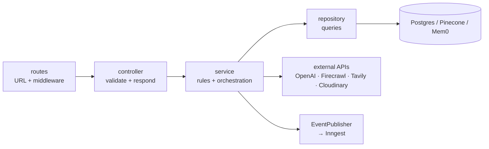

<details>
<summary>Diagram not rendering (e.g. in the GitHub mobile app)? View it as an image</summary>

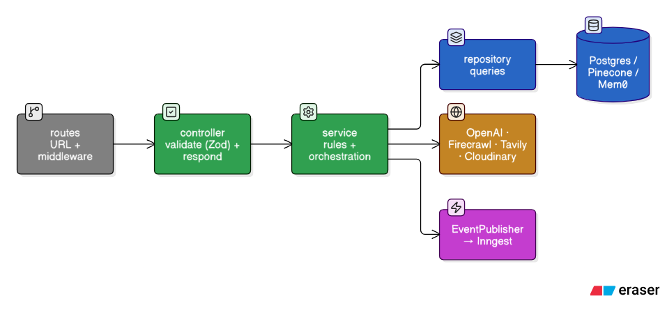

</details>

Rules the code follows:

- **Controllers are thin.** They parse `req.params` / `req.body` / `req.query` with a Zod schema,
  call one service method, and respond with `APIResponse.*`. No business logic.
- **Services own the rules.** Ownership checks, defaults, which repository to call, which event
  to publish. Services may call other services (for example `ChatService` calls
  `ConversationService`, `RetrievalService` and `MemoryService`).
- **Repositories only do data access.** No HTTP concepts, no ownership checks, no try/catch for
  Prisma errors (the global error handler maps those).
- **Ownership is enforced in one place.** `WorkspaceService.getForUser(workspaceId, userId)` throws
  404 when the workspace doesn't belong to the user. Every workspace-scoped service calls it
  first. Other users' resources answer **404, not 403**, so ids can't be probed.
- **Errors are thrown, not returned.** Anything can `throw APIError.NotFound(...)`; the error
  handler turns it into the response envelope.

---

## 6. Life of an HTTP request

The middleware order in [`src/app.ts`](../src/app.ts) matters:

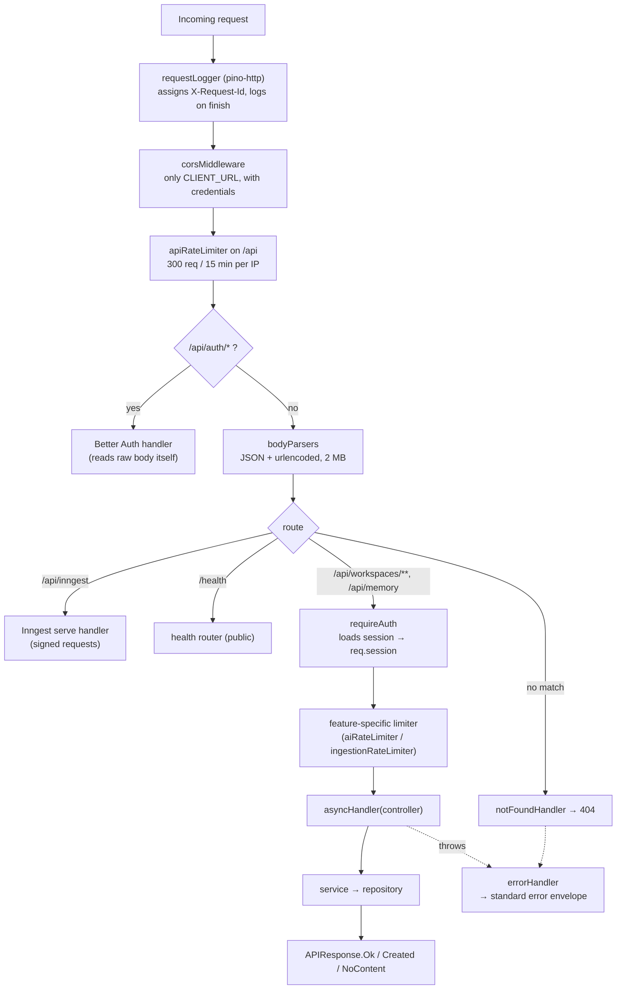

<details>
<summary>Diagram not rendering (e.g. in the GitHub mobile app)? View it as an image</summary>

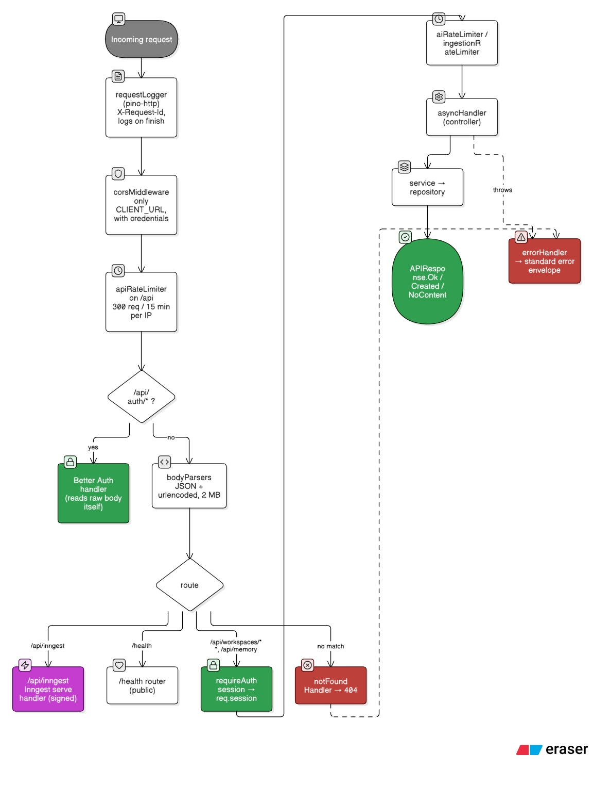

</details>

Why this order:

1. **Logger first** so even rejected requests get a request id and a log line.
2. **Rate limiter before auth** so login attempts are rate limited too.
3. **Better Auth before body parsers** because it reads the raw request body itself.
4. **Feature limiters after `requireAuth`** so they can key on the user id instead of the IP.
5. **On uploads, the limiter runs before multer**, so rejected requests never buffer a file.
6. **`notFoundHandler` and `errorHandler` last.**

---

## 7. Authentication

Implemented by **Better Auth** ([`src/config/auth.ts`](../src/config/auth.ts)).

- Better Auth's routes are mounted at `/api/auth/*`: `sign-up/email`, `sign-in/email`,
  `sign-in/social` (Google), `get-session`, `sign-out`, and so on.
- Users, sessions and accounts are stored in Postgres through the Prisma adapter
  (see [DATABASE.md](DATABASE.md#auth-tables-better-auth)).
- On sign-in, Better Auth sets an **HTTP-only session cookie**. The browser sends it on every
  request (CORS allows credentials from `CLIENT_URL` only).
- **`requireAuth`** ([`require-auth.middleware.ts`](../src/shared/middleware/require-auth.middleware.ts))
  calls `auth.api.getSession()` with the request headers. With no valid session it throws
  401; otherwise it sets `req.session` (`{ user, session }`), typed via `shared/types/session.types.ts`.
- **Login methods:**
    - **Google OAuth:** enabled when `GOOGLE_CLIENT_ID` and `GOOGLE_CLIENT_SECRET` are set.
    - **Email + password:** enabled **only outside production** (development and testing
      convenience; the Postman collection and smoke test use it).
- `GET /api/me` returns the signed-in user.

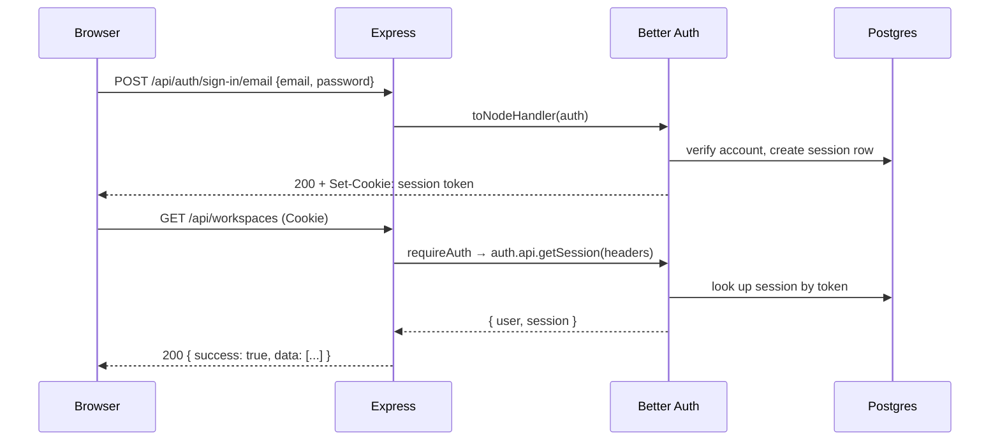

<details>
<summary>Diagram not rendering (e.g. in the GitHub mobile app)? View it as an image</summary>

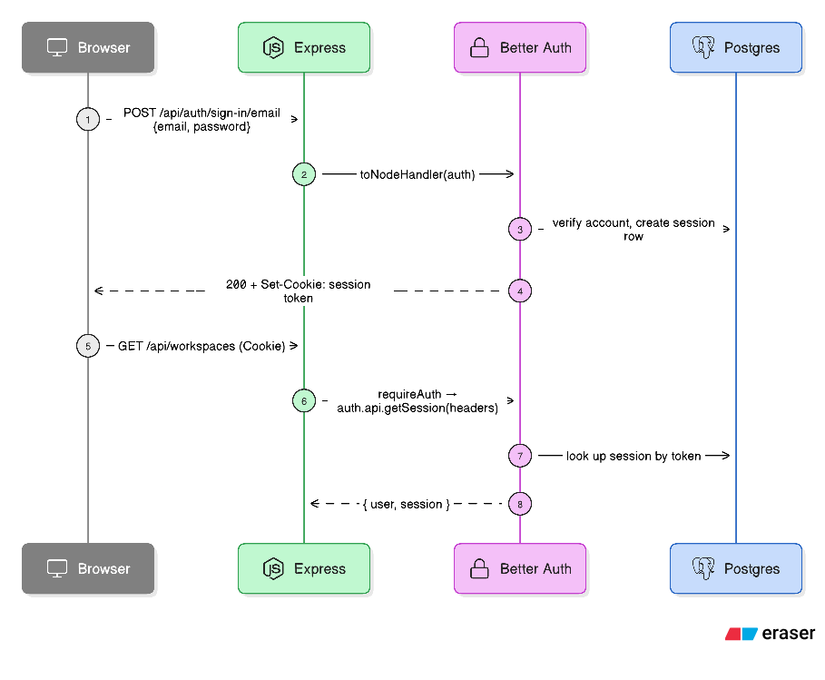

</details>

---

## 8. Feature deep dives

### 8.1 Workspaces

`/api/workspaces` · [`features/workspace/`](../src/features/workspace/)

A workspace is a notebook: a title, an optional description and emoji icon, and a
`defaultModel` used by chat when the request doesn't name one.

- `WorkspaceService.getForUser` is the **ownership gate** used by every other feature.
- **Deleting a workspace** (`WorkspaceService.delete`):
    1. verifies ownership,
    2. publishes `workspace/deleted`, which **cancels** any running source-processing or artifact jobs for it,
    3. deletes the Pinecone namespace (best effort: logged if it fails),
    4. deletes the row; Postgres cascades remove sources, chunks, conversations, messages and artifacts.

The workspace router applies `requireAuth` once, and the other workspace-scoped routers are
nested under it with `mergeParams` (see [`src/routes.ts`](../src/routes.ts)), so they inherit
auth and receive `:workspaceId`.

### 8.2 Sources and the ingestion pipeline

`/api/workspaces/:workspaceId/sources` · [`features/source/`](../src/features/source/)

#### Ways to add a source

| Endpoint                          | Type                | What happens inside the request                                                                         |
| --------------------------------- | ------------------- | ------------------------------------------------------------------------------------------------------- |
| `POST /`                          | `TEXT` / `MARKDOWN` | Content is in the body; saved as is                                                                     |
| `POST /upload` (multipart `file`) | `PDF`               | **Validated** (`PdfValidator`), **uploaded** to Cloudinary, text extracted best effort (`PdfExtractor`) |
| `POST /import/website`            | `WEBSITE`           | Scraped to markdown by **Firecrawl**                                                                    |
| `POST /import/youtube`            | `YOUTUBE`           | Transcript fetched with **youtube-transcript**                                                          |
| `POST /import/web-search`         | `WEBSITE`           | A web result the user chose to keep (title + content + URL)                                             |

Every path ends in `SourceService.createAndQueue`: insert the row as `PENDING` and publish
`source/created`. The request returns **201** right away with the `PENDING` source; the client
polls `GET /:sourceId` until `status` is `READY` or `FAILED`.

#### PDF upload safety

Uploaded files are served back to users, so they are checked before anything is stored:

1. **multer** (cheap, client-claimed): `.pdf` extension, PDF MIME type, ≤ 10 MB, one file.
2. **`PdfValidator.assertSafe`** (the real bytes):
    - `%PDF-` header within the first 1024 bytes,
    - no active-content tokens (`/JavaScript`, `/Launch`, `/EmbeddedFile`, `/XFA`, ...),
    - parses with pdf.js; rejects password-protected files and files over 1000 pages,
    - no attachments and no document- or page-level JavaScript actions.
3. **`PdfValidator.sanitizeFilename`**: strips paths and illegal characters, caps length, keeps `.pdf`.

#### The processing pipeline (background)

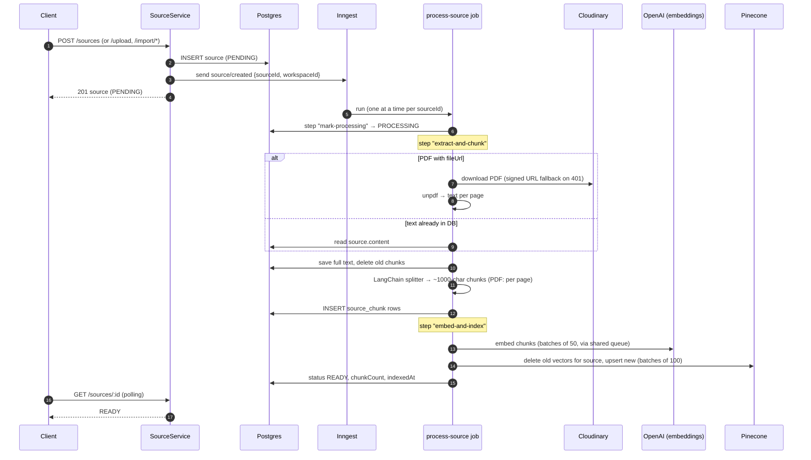

<details>
<summary>Diagram not rendering (e.g. in the GitHub mobile app)? View it as an image</summary>

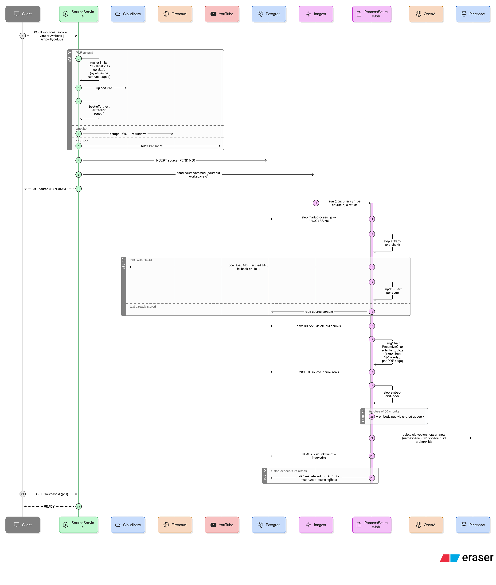

</details>

Details worth knowing:

- **Each step is retried separately.** If embedding fails, extraction is not redone. The job
  has 3 retries; if they run out, `mark-failed` sets `FAILED` and stores the message in
  `metadata.processingError`.
- **Why extract and chunk in one step:** Inngest stores each step's return value, and that state
  is size-limited. Keeping the full text and pages inside one step means only `{ chunkCount }`
  is returned.
- **Chunking** ([`ingestion/chunking.ts`](../src/features/source/ingestion/chunking.ts)):
  `CHUNK_SIZE = 1000` characters, `CHUNK_OVERLAP = 100`. PDF chunks never span two pages and
  carry `metadata.page`, which is what makes "page 3" citations possible.
- **Old vectors are deleted before upserting** because chunk ids change on every run;
  upserting alone would leave the previous run's vectors orphaned.
- **Deleted mid-run?** After upserting, the job checks the source still exists. If it doesn't,
  it removes the vectors it just wrote.
- **Concurrency key `sourceId`, limit 1:** a reprocess request waits for the active run instead of racing it.
- **Cancellation:** `source/deleted` or `workspace/deleted` cancels a running job.

#### Reprocessing and deleting

- `POST /:sourceId/reprocess` (202): removes vectors and chunks, resets status to `PENDING`,
  clears `processingError`, re-publishes `source/created`.
- `POST /reprocess` (200): does the same for every `FAILED` source (or only those in `sourceIds`).
- `DELETE /:sourceId` (204): publishes `source/deleted`, removes vectors and chunks, deletes the row.
- `POST /bulk-delete` (204): deletes each listed source in turn.

### 8.3 Chat (RAG)

`POST /api/workspaces/:workspaceId/chat` · [`features/chat/`](../src/features/chat/)

**RAG** (retrieval-augmented generation) means: find the passages of the user's own sources
that are relevant to the question, put them in the prompt, and tell the model to answer only
from them and cite them.

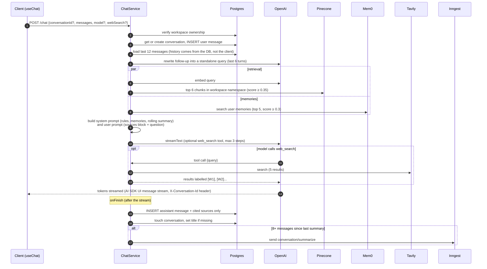

<details>
<summary>Diagram not rendering (e.g. in the GitHub mobile app)? View it as an image</summary>

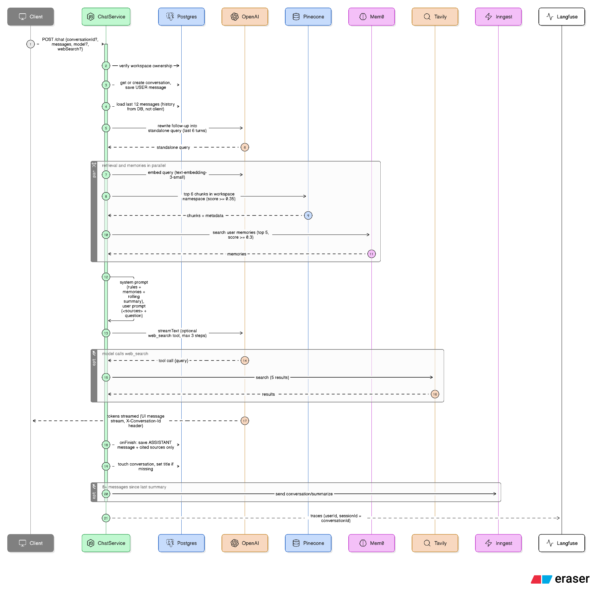

</details>

Step by step ([`chat.service.ts`](../src/features/chat/chat.service.ts)):

1. **Model choice:** `body.model`, else the workspace's `defaultModel`, else `gpt-4o-mini`. Only
   values in `CHAT_MODELS` are accepted.
2. **Only the latest user message is read** from the request. History is loaded from Postgres,
   so a client can't inject fake assistant turns and requests stay small.
3. **Query rewriting** (`RetrievalService.rewriteQuery`): a follow-up like "explain that more"
   embeds badly, so a cheap model call rewrites it into a standalone query using the last 6
   turns. On failure it falls back to the raw message.
4. **Retrieval** (`RetrievalService.retrieve`): embed the query, search the workspace's Pinecone
   namespace for the top `RAG_TOP_K = 6` chunks, drop anything under `RAG_MIN_SCORE = 0.35`.
5. **Memories** (`MemoryService.search`): relevant Mem0 facts about the user, in parallel with retrieval.
6. **Prompt building** (`ChatPrompt`):
    - The **system prompt** holds the rules, the user's memories and the rolling conversation summary.
    - The retrieved chunks go in the **user turn** inside `<sources><source id="1" ...>` tags,
      never in the system prompt, so untrusted document text never carries system-level authority.
    - `escapeDelimiters` neutralises any `<source>` / `</sources>` / `<memories>` text inside documents
      so a document can't close the block and inject instructions.
    - With no relevant chunks, the prompt tells the model to say so and answer from general knowledge
      (or use web search).
7. **Streaming** (`streamText`): the AI SDK streams a UI message stream that `useChat` renders
   directly. If web search is on (and Tavily is configured), the model gets a `web_search` tool;
   up to 3 steps let it search and then answer.
8. **After the stream** (`onFinish`): save the assistant message with only the citations it
   actually used (`ChatPrompt.extractCitationMarkers` parses `[1]`, `[W2]`, `[1, 3]`), bump the
   conversation, set its title, and queue a summary when 8+ messages have accumulated since the
   last one. Errors here are logged, because the response has already been sent.
9. **Errors during the stream** are reported inside the stream (headers are already sent):
   rate-limit messages are passed through; anything else becomes a generic message.

Retrieval and memory search use the **rewritten** query; the model sees the **original** question.

### 8.4 Conversations, rolling summaries and learned memories

`/api/workspaces/:workspaceId/conversations` · [`features/conversation/`](../src/features/conversation/)

Most conversations are created implicitly by the first chat message (titled from it). `POST /`
creates an empty one for an explicit "new chat" button.

Long chats would eventually overflow the model's context, so the app keeps a **rolling summary**:

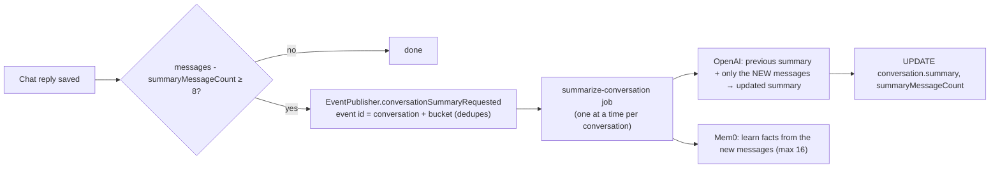

<details>
<summary>Diagram not rendering (e.g. in the GitHub mobile app)? View it as an image</summary>

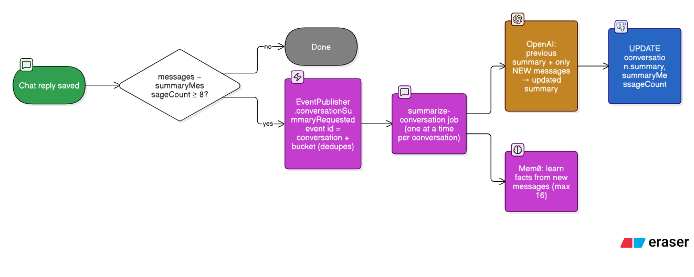

</details>

- The model always sees the **last 12 messages** plus the **summary** of everything older.
- Each run only sends the messages added since the last summary, so cost stays flat as the chat grows.
- Comparing against `summaryMessageCount` (instead of `count % 8`) means an aborted turn can't
  shift the count off the interval and stop summaries forever.
- This job is **the only place chat memories are learned**: the same new messages are sent to
  Mem0 with `infer: true`, and Mem0 decides what is worth remembering.

### 8.5 Memory (Mem0)

`/api/memory` · [`features/memory/`](../src/features/memory/)

**What Mem0 is:** a hosted "memory layer" for LLM apps. You send it conversation turns; it uses
an LLM to extract durable facts ("prefers short answers", "is preparing for a biology exam"),
de-duplicates and updates them over time, and lets you semantically search them later. Memories
are per **user**, across all workspaces.

Two sources of memories:

| Source    | How it is created                                          | `metadata.source` |
| --------- | ---------------------------------------------------------- | ----------------- |
| `learned` | Background summary job → Mem0 infers facts from chat turns | `learned`         |
| `manual`  | `POST /api/memory`, stored verbatim (`infer: false`)       | `manual`          |

How they are used: on every chat message, `MemoryService.search` finds up to 5 relevant memories
(score ≥ 0.3), and they go into the system prompt inside a `<memories>` block.

Behaviour without Mem0 (`MEM0_API_KEY` unset): reads return empty lists, so chat keeps working;
writes (`POST`/`PATCH`/`DELETE /api/memory`) return 503.

Ownership: Mem0 returns each memory's `userId`; updating or deleting another user's memory
returns 404. Malformed ids (Mem0 rejects non-UUIDs) are treated as not found.

### 8.6 Learning artifacts

`/api/workspaces/:workspaceId/artifacts` · [`features/artifact/`](../src/features/artifact/)

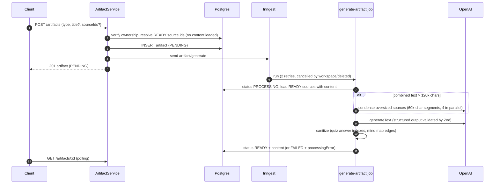

<details>
<summary>Diagram not rendering (e.g. in the GitHub mobile app)? View it as an image</summary>

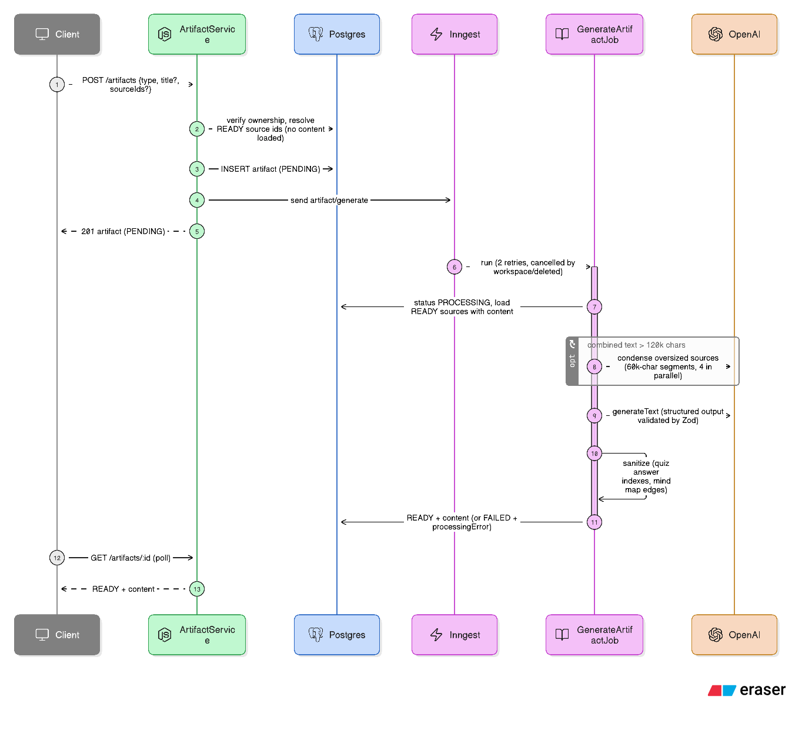

</details>

- **Types:** `SUMMARY` (markdown), `TAKEAWAYS`, `FLASHCARDS`, `QUIZ`, `MINDMAP`, `REPORT`.
  All but `SUMMARY` use `Output.object({ schema })`, so the model must return JSON matching a
  Zod schema. Shapes are listed in [DATABASE.md](DATABASE.md#learning_artifactcontent-by-type).
- **Fitting large sources into one prompt** (`ArtifactGenerationService.gatherSourceContext`):
    - If all sources fit in `ARTIFACT_MAX_CONTEXT_CHARS` (120,000), they are used verbatim.
    - Otherwise `allocateBudgets` splits the budget fairly: small sources keep their full text and
      the leftover goes to larger ones.
    - Oversized sources are **condensed** (map step): cut into 60,000-char segments, each
      summarised into dense notes, then joined. Every part of a long document is represented
      instead of just its beginning, and later sources are never silently dropped.
- **Sanitising model output:** quiz questions whose `correctIndex` is out of range are dropped
  (fewer than 3 valid → throw, so Inngest retries); mind-map edges pointing at unknown nodes,
  self-loops and duplicates are removed so the client graph can't crash.
- `sourceIds` is stored on the artifact as a snapshot, not a foreign key.

### 8.7 Health checks

`/health` · [`features/health/`](../src/features/health/)

| Endpoint            | Purpose                                              | Touches dependencies?  |
| ------------------- | ---------------------------------------------------- | ---------------------- |
| `GET /health`       | **Liveness**: the process is up. For load balancers. | No                     |
| `GET /health/ready` | **Readiness**: probes every dependency in parallel.  | Yes (free probes only) |

Readiness checks (each with a 5 s timeout; results cached for 10 s):

| Check                 | Required | Probe                                                               |
| --------------------- | -------- | ------------------------------------------------------------------- |
| `database`            | yes      | `SELECT 1`                                                          |
| `pinecone`            | yes      | index stats (creates the index if missing)                          |
| `openai`              | yes      | retrieve the chat model (validates key and model access, no tokens) |
| `inngest`             | yes      | dev: ping the local dev server; cloud: keys are set                 |
| `mem0`                | no       | ping                                                                |
| `cloudinary`          | no       | Admin API ping when signing credentials exist                       |
| `firecrawl`, `tavily` | no       | configured or not (no free probe)                                   |
| `langfuse`            | no       | public health endpoint                                              |

Overall status: `down` (503) if a required check fails, `degraded` (200) if only optional ones
fail, otherwise `ok`. Latency and error text are included only outside production.

---

## 9. Background jobs (Inngest)

**What Inngest is:** an event-driven job platform. Your code sends an **event**
(`inngest.send({ name: "source/created", data })`); Inngest decides which **functions** listen for
it and **calls your app over HTTP** at `/api/inngest` to run them. Each `step.run(...)` inside a
function is checkpointed: if a later step fails, only that step is retried. There is no queue,
broker or worker process to operate.

- Locally, `npm run dev` starts the **Inngest dev server** (dashboard at http://localhost:8288),
  which shows every event, run, step, retry and error.
- In production, Inngest Cloud calls `/api/inngest`, and requests are signed with `INNGEST_SIGNING_KEY`.

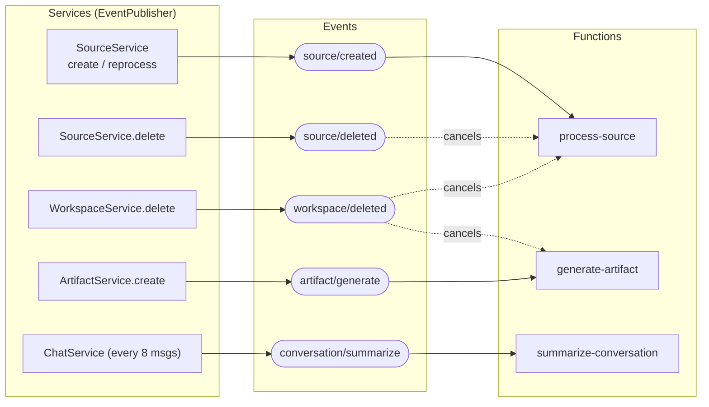

<details>
<summary>Diagram not rendering (e.g. in the GitHub mobile app)? View it as an image</summary>

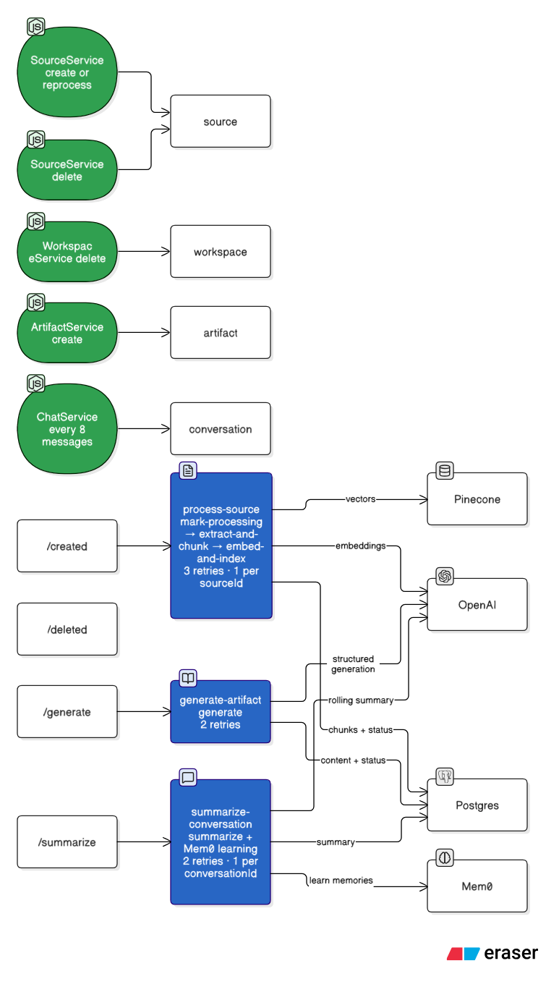

</details>

| Function                 | Trigger                  | Steps                                                                         | Retries | Concurrency            | Cancelled by                          |
| ------------------------ | ------------------------ | ----------------------------------------------------------------------------- | ------- | ---------------------- | ------------------------------------- |
| `process-source`         | `source/created`         | `mark-processing` → `extract-and-chunk` → `embed-and-index` (→ `mark-failed`) | 3       | 1 per `sourceId`       | `source/deleted`, `workspace/deleted` |
| `generate-artifact`      | `artifact/generate`      | `generate`                                                                    | 2       | default                | `workspace/deleted`                   |
| `summarize-conversation` | `conversation/summarize` | `summarize`                                                                   | 2       | 1 per `conversationId` | none                                  |

- Event payloads are validated with Zod at the start of each function, so a malformed event fails loudly.
- `conversation/summarize` events have an id built from the conversation and a message-count
  bucket, so repeated triggers before the job runs are de-duplicated by Inngest.
- Jobs wrap their work in Langfuse `propagateAttributes`, so traces are grouped by user/conversation.
- If the dev server isn't running, sources stay `PENDING` and artifacts never start.
  `GET /health/ready` reports `inngest: down`.

---

## 10. The AI layer

> For the comprehensive visual diagram and execution loop walkthrough covering **OpenAI**, **Mem0**, and the **Vector Database (Qdrant / Pinecone)**, see [Section 2.1: GenAI Core Architecture](#21-genai-core-architecture-openai--mem0--vector-database-qdrant--pinecone).

### Where OpenAI is called

| Caller                                      | API                                       | Model                    | Purpose                             |
| ------------------------------------------- | ----------------------------------------- | ------------------------ | ----------------------------------- |
| `ChatService.streamReply`                   | AI SDK `streamText`                       | `gpt-4o-mini` / `gpt-4o` | The chat answer (streamed)          |
| `RetrievalService.rewriteQuery`             | AI SDK `generateText`                     | `gpt-4o-mini`            | Standalone retrieval query          |
| `ArtifactGenerationService.generateContent` | AI SDK `generateText` (+ `Output.object`) | `gpt-4o-mini`            | Artifact content                    |
| `condenseSource` (artifact generation)      | AI SDK `generateText`                     | `gpt-4o-mini`            | Condensing oversized sources        |
| `ConversationMemoryService.summarize`       | AI SDK `generateText`                     | `gpt-4o-mini`            | Rolling conversation summary        |
| `EmbeddingClient.embed`                     | `openai` SDK embeddings                   | `text-embedding-3-small` | Chunk and query vectors (1536 dims) |
| `HealthRepository.openai`                   | `openai` SDK models                       | –                        | Readiness probe                     |

Mem0 also uses an LLM internally (on Mem0's side) to extract memories.

### The shared OpenAI queue

[`src/config/openai.ts`](../src/config/openai.ts) puts **every** OpenAI request through one
`p-queue`:

- `OPENAI_MAX_CONCURRENCY` (default 4) requests in flight,
- `OPENAI_REQUESTS_PER_MINUTE` (default 300),
- `OPENAI_MAX_QUEUE` (default 100) waiting; beyond that, callers get **429** right away
  ("The AI service is busy") instead of waiting indefinitely.

AI SDK models are wrapped with middleware (`openai(modelId)`) that schedules each call on the
queue; for streams, the slot is held until the stream starts. Embeddings call `scheduleOpenAI`
directly. Indexing a big PDF therefore can't starve chat, and a burst of users can't push the
account over its limit. The `openai` SDK also retries 429/5xx responses with backoff.

### Prompts

Every prompt is in [`src/config/prompts.ts`](../src/config/prompts.ts). Services decide when to
call the model; the wording lives in one file. All tunable numbers (models, chunk sizes,
thresholds, windows) are in [`src/config/ai.config.ts`](../src/config/ai.config.ts).

### Prompt-injection defences

Sources and web results are untrusted text. The app:

- puts retrieved text in the **user** turn, inside delimited `<sources>` blocks, never in the system prompt,
- escapes delimiter-like tags inside that text (`escapeDelimiters`),
- tells the model in the system prompt that `<sources>` and web results are data, not instructions,
- loads chat history from the database rather than trusting the client.

### Telemetry (Langfuse)

[`src/config/telemetry.ts`](../src/config/telemetry.ts) registers an OpenTelemetry tracer with
the Langfuse span processor and the Langfuse AI SDK integration. Every AI SDK call carries a
`functionId` (`chat`, `query-rewrite`, `artifact-quiz`, `conversation-summary`, ...), and chat and
jobs add `userId` / `sessionId` (conversation id), so Langfuse shows each conversation's full
trace. Embeddings use the raw OpenAI SDK and are not traced. Tracing is off unless both
`LANGFUSE_*` keys are set. Spans are flushed on shutdown (bounded to 5 s).

---

## 11. Errors and the response envelope

Every JSON response uses one envelope ([`api-response.ts`](../src/shared/http/api-response.ts)):

```json
{ "success": true, "data": { "id": "..." }, "message": "optional" }
{ "success": false, "error": { "code": "NOT_FOUND", "message": "Workspace not found", "details": {} } }
```

Exceptions: `204 No Content` has no body; `POST /chat` returns a stream.

Code throws `APIError` factories ([`api-error.ts`](../src/shared/http/api-error.ts)):

| Factory              | Status | Code                    |
| -------------------- | ------ | ----------------------- |
| `BadRequest`         | 400    | `BAD_REQUEST`           |
| `Validation`         | 400    | `VALIDATION_ERROR`      |
| `Unauthorized`       | 401    | `UNAUTHORIZED`          |
| `Forbidden`          | 403    | `FORBIDDEN`             |
| `NotFound`           | 404    | `NOT_FOUND`             |
| `Conflict`           | 409    | `CONFLICT`              |
| `PayloadTooLarge`    | 413    | `PAYLOAD_TOO_LARGE`     |
| `TooManyRequests`    | 429    | `TOO_MANY_REQUESTS`     |
| `Internal`           | 500    | `INTERNAL_SERVER_ERROR` |
| `ServiceUnavailable` | 503    | `SERVICE_UNAVAILABLE`   |

The global `errorHandler` ([`error-handler.middleware.ts`](../src/shared/middleware/error-handler.middleware.ts))
also converts other errors:

| Thrown                            | Becomes                                                                              |
| --------------------------------- | ------------------------------------------------------------------------------------ |
| `ZodError`                        | 400 `VALIDATION_ERROR`, `details` = field errors                                     |
| `MulterError`                     | 413 (file too large) or 400                                                          |
| Prisma errors                     | 404 / 409 / 503 (see [DATABASE.md](DATABASE.md#how-prisma-errors-become-api-errors)) |
| OpenAI rate limit (after retries) | 429                                                                                  |
| body-parser errors                | 413 (too large) or 400 (invalid JSON)                                                |
| Cloudinary 403                    | 400 with a hint about API key permissions                                            |
| anything else                     | 500 with a generic message; the original error is logged with the request id         |

---

## 12. Rate limiting

**Inbound** (express-rate-limit, [`rate-limit.middleware.ts`](../src/shared/middleware/rate-limit.middleware.ts)):

| Limiter                | Applies to                                 | Limit        | Keyed by |
| ---------------------- | ------------------------------------------ | ------------ | -------- |
| `apiRateLimiter`       | All `/api` traffic (except `/api/inngest`) | 300 / 15 min | IP       |
| `aiRateLimiter`        | `POST /chat`, `POST /artifacts`            | 20 / min     | user     |
| `ingestionRateLimiter` | Create, upload, imports, reprocess         | 30 / 10 min  | user     |

Responses include `RateLimit-*` headers (draft-8). Counters are in memory, so they are per
instance. Behind a proxy, set `TRUST_PROXY_HOPS` so the real client IP is used.

**Outbound:** the shared OpenAI queue (see [§10](#the-shared-openai-queue)).

---

## 13. Logging and observability

- **pino** root logger ([`config/logger.ts`](../src/config/logger.ts)): JSON lines in production,
  pretty-printed in development. Level from `LOG_LEVEL` (default `info` in production, `debug` otherwise).
  `authorization`, `cookie` and `set-cookie` headers are redacted.
- **pino-http** ([`request-logger.middleware.ts`](../src/shared/middleware/request-logger.middleware.ts)):
  one line per request with method, URL, status, duration, request id and user id.
  4xx logs at `warn`, 5xx at `error` with the error attached. `/health` polls are not logged.
- **Request ids:** each response has an `X-Request-Id` header. A caller-supplied `X-Request-Id`
  (letters, digits, `_`, `-`, ≤ 64 chars) is reused, so ids can follow a request across services.
- **`req.log`** is a request-scoped child logger.
- **Where logs go:** pino writes to stdout only, so locally they appear in the `[api]` lines of
  the `npm run dev` terminal, and in production your host captures them (Render/Railway logs tab,
  `docker logs`, CloudWatch, ...). Nothing is written to disk.
- **Axiom (optional):** set `AXIOM_TOKEN` (plus `AXIOM_DATASET`, and `AXIOM_EDGE` for the region)
  and every log line is also shipped to [Axiom](https://axiom.co) through the `@axiomhq/pino`
  transport, alongside the console output. Search there by `req.id` (the `X-Request-Id`),
  `userId`, `level` or `msg`. The free plan keeps logs for 30 days.
- **Langfuse** for LLM calls (see [§10](#telemetry-langfuse)); **Inngest dashboard** for jobs;
  **Prisma Studio** (`npm run db:studio`) for data.

---

## 14. Configuration

All environment variables are validated at boot by [`src/config/env.ts`](../src/config/env.ts);
the server exits with a readable list of problems if anything is wrong. Nothing else reads
`process.env`. Blank values (`FOO=`) count as unset. Copy [`.env.example`](../.env.example) to `.env`.

| Variable                                             | Required   | Default                       | Purpose                                                                |
| ---------------------------------------------------- | ---------- | ----------------------------- | ---------------------------------------------------------------------- |
| `NODE_ENV`                                           |            | `development`                 | `development` / `test` / `production`                                  |
| `PORT`                                               |            | `8080`                        | HTTP port                                                              |
| `CLIENT_URL`                                         |            | `http://localhost:3000`       | Web client origin (CORS, trusted origin)                               |
| `TRUST_PROXY_HOPS`                                   |            | `0`                           | Reverse proxies in front of the app                                    |
| `LOG_LEVEL`                                          |            | `debug` / `info`              | pino level                                                             |
| `DATABASE_URL`                                       | **yes**    |                               | Postgres connection string                                             |
| `BETTER_AUTH_SECRET`                                 | **yes**    |                               | Signs sessions; long random string                                     |
| `BETTER_AUTH_URL`                                    |            | `CLIENT_URL`                  | Public base URL of the auth routes                                     |
| `GOOGLE_CLIENT_ID` / `GOOGLE_CLIENT_SECRET`          | pair       |                               | Google login                                                           |
| `OPENAI_API_KEY`                                     | **yes**    |                               | OpenAI                                                                 |
| `OPENAI_MAX_CONCURRENCY`                             |            | `4`                           | Outbound queue concurrency                                             |
| `OPENAI_REQUESTS_PER_MINUTE`                         |            | `300`                         | Outbound queue rate                                                    |
| `OPENAI_MAX_QUEUE`                                   |            | `100`                         | Waiting calls before 429                                               |
| `PINECONE_API_KEY`                                   | **yes**    |                               | Pinecone                                                               |
| `PINECONE_INDEX`                                     |            | `grounded-brain-notebook-llm` | Index name (auto-created: 1536 dims, cosine, AWS us-east-1 serverless) |
| `INNGEST_DEV`                                        |            |                               | `1` to use the local dev server                                        |
| `INNGEST_EVENT_KEY` / `INNGEST_SIGNING_KEY`          | **prod**   |                               | Inngest Cloud                                                          |
| `CLOUDINARY_CLOUD_NAME` / `CLOUDINARY_UPLOAD_PRESET` | pair       |                               | PDF uploads (unsigned preset)                                          |
| `CLOUDINARY_API_KEY` / `CLOUDINARY_API_SECRET`       | pair       |                               | Signed downloads of private PDFs                                       |
| `FIRECRAWL_API_KEY`                                  |            |                               | Website imports                                                        |
| `TAVILY_API_KEY`                                     |            |                               | Web search                                                             |
| `MEM0_API_KEY`                                       |            |                               | Memories                                                               |
| `LANGFUSE_PUBLIC_KEY` / `LANGFUSE_SECRET_KEY`        | pair       |                               | LLM tracing                                                            |
| `LANGFUSE_BASE_URL`                                  |            | EU cloud                      | Langfuse region or self-hosted URL                                     |
| `AXIOM_TOKEN`                                        |            |                               | Ship logs to Axiom (ingest token); off when unset                      |
| `AXIOM_DATASET`                                      | with token |                               | Axiom dataset name                                                     |
| `AXIOM_EDGE`                                         |            | US                            | Regional ingest domain, e.g. `us-east-1.aws.edge.axiom.co`             |

"pair" means both must be set or neither. Optional integrations degrade gracefully: their
endpoints return **503** and the rest of the app keeps working.

---

## 15. Local development and Docker

**Why Docker?** The app needs PostgreSQL. Instead of everyone installing and configuring
Postgres by hand, [`docker-compose.yml`](../docker-compose.yml) runs the exact version
(`postgres:16`) with the right database, user and password, a persistent volume
(`grounded_brain_data`) and a health check. `docker compose up -d --wait` blocks until the
database accepts connections. It is exposed on **port 5434** (not 5432) so it doesn't clash with
a Postgres you may already have. Only Postgres runs in Docker; Pinecone, Mem0 and the other
services are cloud APIs, and the app itself runs with Node.

**`npm run dev`** does everything in order:

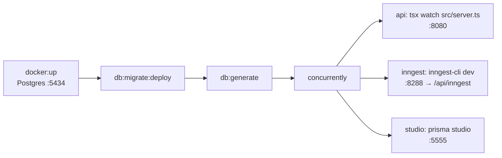

<details>
<summary>Diagram not rendering (e.g. in the GitHub mobile app)? View it as an image</summary>

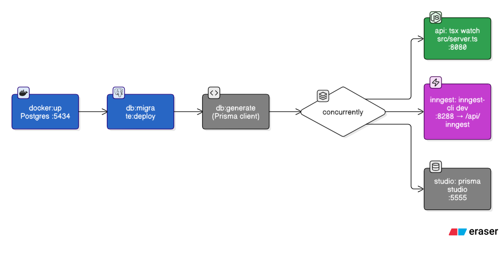

</details>

| Port   | Service                        |
| ------ | ------------------------------ |
| `8080` | API                            |
| `8288` | Inngest dev server + dashboard |
| `5555` | Prisma Studio                  |
| `5434` | Postgres (Docker)              |

Other scripts: `npm run check` (typecheck + lint + format check), `npm run lint:fix`,
`npm run format`, `npm run smoke`, `npm run docker:down`, `npm run docker:reset`.

---

## 16. Deployment

There is no Dockerfile for the API yet; it deploys as a regular Node service (Render, Railway,
Fly.io, a VM, ECS, ...).

**Build and start**

```bash
npm ci
npm run build              # prisma generate && tsc → dist/
npm run db:migrate:deploy  # apply migrations (run once per release, before starting)
npm start                  # node dist/server.js
```

**Production checklist**

- [ ] `NODE_ENV=production`. JSON logs, no latency/error details in `/health/ready`,
      **email/password login disabled** (configure Google OAuth).
- [ ] Managed Postgres (Neon, Supabase, RDS, ...) in `DATABASE_URL`.
- [ ] Strong `BETTER_AUTH_SECRET`; `BETTER_AUTH_URL` and `CLIENT_URL` set to the real public URLs (HTTPS).
- [ ] **Inngest Cloud:** set `INNGEST_EVENT_KEY` and `INNGEST_SIGNING_KEY` (boot fails without them),
      leave `INNGEST_DEV` unset, and register the app URL `https://<api-host>/api/inngest` in the Inngest dashboard.
- [ ] Behind a load balancer/CDN: `TRUST_PROXY_HOPS` = number of proxies.
- [ ] Health checks: liveness `GET /health`, readiness `GET /health/ready`.
- [ ] The process handles `SIGTERM`: stops accepting connections and flushes traces.
- [ ] Tune `OPENAI_*` limits to your OpenAI tier.
- [ ] Optional: Langfuse keys for tracing; Axiom keys for stored, searchable logs; Cloudinary, Firecrawl, Tavily, Mem0 keys for those features.
- [ ] **Running more than one instance:** inbound rate-limit counters are per instance, and so
      is the OpenAI queue. Use a shared store (for example `rate-limit-redis`) if limits must be global.

---

## 17. Function reference

The key functions, by module. Every function also has JSDoc in the code.

### `config/`

| Function / export                                                              | What it does                                              |
| ------------------------------------------------------------------------------ | --------------------------------------------------------- |
| `env`, `isProduction`, `inngestDevMode`                                        | Validated configuration                                   |
| `openai(modelId)`                                                              | AI SDK model routed through the shared queue              |
| `scheduleOpenAI(task)`                                                         | Runs any OpenAI call through the queue (429 if full)      |
| `openaiClient`                                                                 | Raw OpenAI SDK client with retries                        |
| `isOpenAIRateLimitError(error)`                                                | Detects OpenAI 429s, including inside AI SDK retry errors |
| `PineconeClient.getIndex()`                                                    | Index handle; creates the index on first use              |
| `Mem0Client` / `TavilyClient` / `FirecrawlClient` `.get()` / `.isConfigured()` | Lazy SDK singletons; `get()` throws 503 if unconfigured   |
| `initTelemetry()` / `shutdownTelemetry()`                                      | Langfuse tracing on/off                                   |

### `shared/`

| Function                                                                   | What it does                                  |
| -------------------------------------------------------------------------- | --------------------------------------------- |
| `EmbeddingClient.embed(texts)`                                             | Embeds strings in order (via the queue)       |
| `VectorRepository.upsert / query / deleteBySourceId / deleteByWorkspaceId` | Pinecone access, per-workspace namespace      |
| `APIError.*`, `APIResponse.*`                                              | Throwing and sending in the standard envelope |
| `asyncHandler(handler)`                                                    | Forwards async errors to the error handler    |
| `requireAuth`                                                              | Session → `req.session`, or 401               |
| `errorHandler`, `notFoundHandler`                                          | Global error mapping, 404 catch-all           |

### `features/source/`

| Function                                                                                 | What it does                              |
| ---------------------------------------------------------------------------------------- | ----------------------------------------- |
| `SourceService.createText / uploadPdf / importWebsite / importYoutube / importWebSearch` | Create a source and queue processing      |
| `SourceService.reprocess / reprocessFailed`                                              | Clear index data and re-queue             |
| `SourceService.delete / bulkDelete`                                                      | Cancel jobs, clear vectors/chunks, delete |
| `SourceProcessingService.extractAndChunk`                                                | Pipeline step 1                           |
| `SourceProcessingService.index`                                                          | Pipeline step 2                           |
| `SourceProcessingService.markProcessing / markFailed / removeFromIndex`                  | Status and cleanup helpers                |
| `TextChunker.chunkText / chunkPages`                                                     | LangChain splitting (+ page numbers)      |
| `PdfValidator.assertSafe / sanitizeFilename`                                             | Upload security                           |
| `PdfExtractor.fromBuffer / fromCloudinary`                                               | PDF → text per page                       |
| `CloudinaryStorage.uploadPdf / getSignedDownloadUrl`                                     | PDF storage                               |
| `FirecrawlScraper.scrape`, `YoutubeClient.fetchTranscript`                               | Imports                                   |

### `features/chat/`

| Function                                         | What it does                                    |
| ------------------------------------------------ | ----------------------------------------------- |
| `ChatService.stream`                             | Entry point; tags traces and runs `streamReply` |
| `RetrievalService.rewriteQuery`                  | Follow-up → standalone query                    |
| `RetrievalService.retrieve`                      | Query → top chunks above the score threshold    |
| `ChatPrompt.buildSystemPrompt / buildUserPrompt` | Prompt assembly with injection defences         |
| `ChatPrompt.extractCitationMarkers`              | Parses `[1]`, `[W2]`, `[1, 3]` from the answer  |
| `TavilySearch.search / formatResultsForPrompt`   | Web search tool                                 |
| `UIMessageUtils.getText / getLastUserText`       | Reading AI SDK UI messages                      |

### `features/conversation/`, `memory/`, `artifact/`, `workspace/`

| Function                                                                                  | What it does                             |
| ----------------------------------------------------------------------------------------- | ---------------------------------------- |
| `ConversationService.getOrCreate / addMessage / getRecentTurns / ensureTitle`             | Chat persistence                         |
| `ConversationMemoryService.summarize`                                                     | Rolling summary + Mem0 learning (job)    |
| `MemoryService.search / learnFromMessages / create / update / delete`                     | Mem0-backed memories                     |
| `ArtifactService.create / generate`                                                       | Queue an artifact / run generation (job) |
| `ArtifactGenerationService.resolveReadySourceIds / gatherSourceContext / generateContent` | Context building and generation          |
| `WorkspaceService.getForUser`                                                             | Ownership gate                           |
| `EventPublisher.*`                                                                        | Every Inngest event                      |

---

## 18. Glossary

| Term                          | Meaning                                                                                         |
| ----------------------------- | ----------------------------------------------------------------------------------------------- |
| **RAG**                       | Retrieval-augmented generation: retrieve relevant text, then generate an answer grounded in it  |
| **Embedding**                 | A list of numbers (1536 here) representing a text's meaning; similar texts have similar vectors |
| **Vector database**           | A store that finds the nearest vectors to a query vector (Pinecone)                             |
| **Namespace**                 | A partition of a Pinecone index; here one per workspace                                         |
| **Chunk**                     | A ~1000-character piece of a source; the unit that is embedded and retrieved                    |
| **Cosine similarity / score** | How close two vectors are (higher = more similar); chunks under 0.35 are ignored                |
| **Query rewriting**           | Turning "explain that more" into a self-contained query before searching                        |
| **Rolling summary**           | A summary of older chat turns that is updated incrementally                                     |
| **Memory (Mem0)**             | A durable fact about the user, reused across conversations and workspaces                       |
| **Artifact**                  | Generated study material (summary, quiz, flashcards, ...)                                       |
| **Event / function / step**   | Inngest: an event triggers a function; a function is made of retryable steps                    |
| **UI message stream**         | The AI SDK's streaming format that `useChat` consumes                                           |
| **Envelope**                  | The `{ success, data }` / `{ success, error }` JSON shape of every response                     |
