# Database

How Grounded Brain stores its data: the PostgreSQL schema, how tables relate, which indexes
exist and why, and which data lives outside Postgres (Pinecone, Mem0, Cloudinary).

- **Database:** PostgreSQL 16 (local: Docker, see [`docker-compose.yml`](../docker-compose.yml))
- **ORM:** Prisma 7 with the `pg` driver adapter ([`src/config/db.ts`](../src/config/db.ts))
- **Schema files:** [`prisma/schema.prisma`](../prisma/schema.prisma) (generator + datasource) and
  one file per model in [`prisma/models/`](../prisma/models/)
- **Migrations:** [`prisma/migrations/`](../prisma/migrations/)

---

## Contents

1. [The big picture](#1-the-big-picture)
2. [ER diagram](#2-er-diagram)
3. [Tables in detail](#3-tables-in-detail)
4. [Relations and cascades](#4-relations-and-cascades)
5. [Indexes and constraints](#5-indexes-and-constraints)
6. [Enums and status lifecycles](#6-enums-and-status-lifecycles)
7. [JSON columns](#7-json-columns)
8. [Data that lives outside Postgres](#8-data-that-lives-outside-postgres)
9. [Model → table name mapping (`@@map`)](#9-model--table-name-mapping-map)
10. [Migrations and workflow](#10-migrations-and-workflow)

---

## 1. The big picture

There are two groups of tables:

| Group              | Tables                                                                                | Owned by                                       |
| ------------------ | ------------------------------------------------------------------------------------- | ---------------------------------------------- |
| **Auth**           | `user`, `session`, `account`, `verification`                                          | Better Auth (we never write to these directly) |
| **App (notebook)** | `workspace`, `source`, `source_chunk`, `conversation`, `message`, `learning_artifact` | Our feature repositories (`*.repository.ts`)   |

Everything in the app group hangs off a **workspace**, and every workspace belongs to one **user**.
That single chain (`user → workspace → everything else`) is how access control works: services
first call `WorkspaceService.getForUser(workspaceId, userId)` and only then touch child rows.

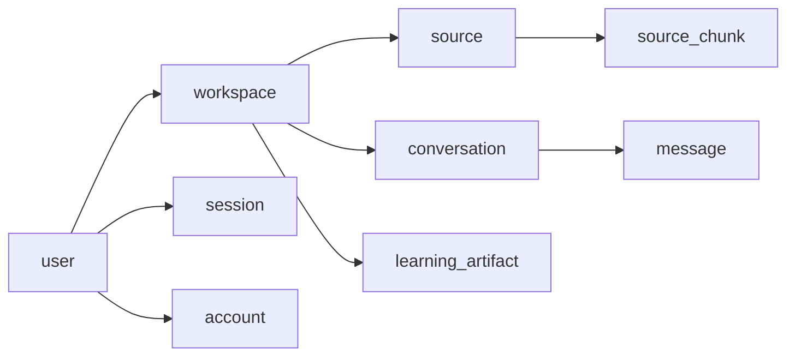

<details>
<summary>Diagram not rendering (e.g. in the GitHub mobile app)? View it as an image</summary>

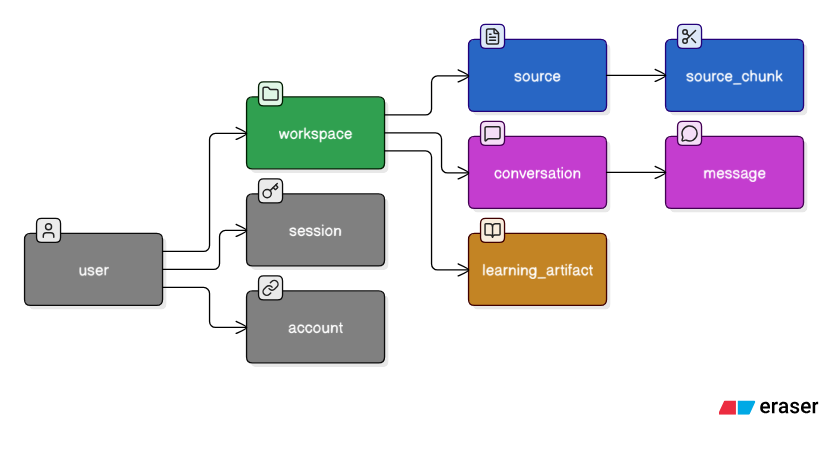

</details>

---

## 2. ER diagram

GitHub renders this diagram. Crow's-foot notation: `||--o{` means "one to zero-or-many".

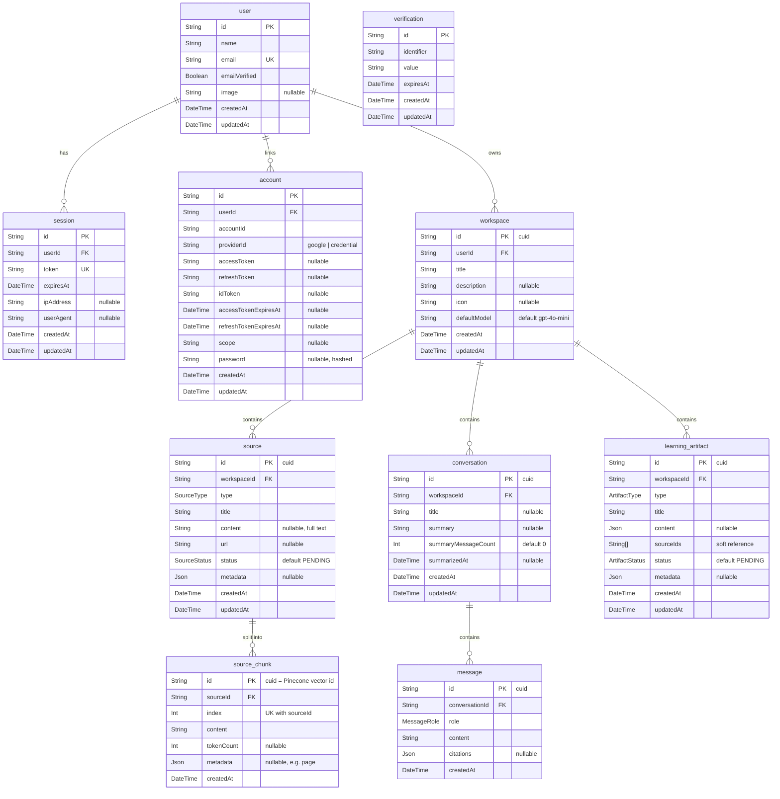

<details>
<summary>Diagram not rendering (e.g. in the GitHub mobile app)? View it as an image</summary>

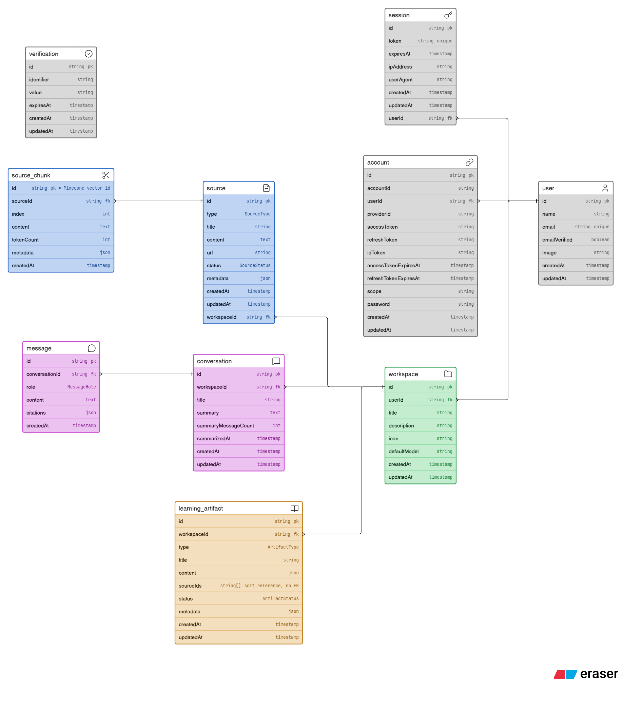

</details>

> An icon-styled version of this diagram is in [`docs/diagrams/database-er.eraser`](diagrams/database-er.eraser).
> Paste it into [eraser.io](https://app.eraser.io) to render it.

---

## 3. Tables in detail

### Auth tables (Better Auth)

These follow the schema Better Auth expects. Their ids are plain strings that Better Auth
generates, not `cuid()`. Read them through Better Auth's API (`auth.api.getSession`), not Prisma.

| Table          | Purpose                                                                                                                  | Notable columns                                                    |
| -------------- | ------------------------------------------------------------------------------------------------------------------------ | ------------------------------------------------------------------ |
| `user`         | A person who can sign in.                                                                                                | `email` is unique.                                                 |
| `session`      | One logged-in browser/device. The session cookie carries `token`.                                                        | `token` unique; `expiresAt`; `ipAddress`/`userAgent` for auditing. |
| `account`      | A login method linked to a user: Google OAuth (`providerId = "google"`) or email/password (`providerId = "credential"`). | OAuth tokens; `password` holds the hash for credential accounts.   |
| `verification` | Short-lived tokens (email verification, password reset).                                                                 | `identifier` (what it verifies), `value` (token), `expiresAt`.     |

### `workspace`

A notebook. Every source, conversation and artifact belongs to exactly one workspace.

| Column                    | Type       | Notes                                                                      |
| ------------------------- | ---------- | -------------------------------------------------------------------------- |
| `id`                      | `String`   | `cuid()`                                                                   |
| `userId`                  | `String`   | FK → `user.id`, **cascade delete**                                         |
| `title`                   | `String`   | 1–120 chars (validated in `workspace.validator.ts`)                        |
| `description`             | `String?`  | ≤ 500 chars                                                                |
| `icon`                    | `String?`  | ≤ 8 chars (an emoji)                                                       |
| `defaultModel`            | `String`   | `gpt-4o-mini` by default; chat uses it when a request doesn't name a model |
| `createdAt` / `updatedAt` | `DateTime` | `updatedAt` is maintained by Prisma (`@updatedAt`)                         |

The workspace id is also the **Pinecone namespace** for that workspace's vectors.

### `source`

Material the workspace is grounded in.

| Column        | Type           | Notes                                                                 |
| ------------- | -------------- | --------------------------------------------------------------------- |
| `id`          | `String`       | `cuid()`                                                              |
| `workspaceId` | `String`       | FK → `workspace.id`, cascade delete                                   |
| `type`        | `SourceType`   | `PDF`, `WEBSITE`, `YOUTUBE`, `TEXT`, `MARKDOWN`                       |
| `title`       | `String`       | ≤ 200 chars                                                           |
| `content`     | `String?`      | Full extracted text. Can be megabytes, so list queries leave it out   |
| `url`         | `String?`      | Original URL for websites/YouTube/web results                         |
| `status`      | `SourceStatus` | Processing lifecycle, see [§6](#6-enums-and-status-lifecycles)        |
| `metadata`    | `Json?`        | File info, page count, chunk count, errors, see [§7](#7-json-columns) |

### `source_chunk`

One piece (~1000 characters) of a source's text. The same chunk is stored twice:

- here in Postgres (text, order, token count), and
- in Pinecone as an embedding vector **whose id is this row's `id`**.

| Column       | Type     | Notes                                                          |
| ------------ | -------- | -------------------------------------------------------------- |
| `sourceId`   | `String` | FK → `source.id`, cascade delete                               |
| `index`      | `Int`    | 0-based position within the source; unique per source          |
| `content`    | `String` | Chunk text                                                     |
| `tokenCount` | `Int?`   | Measured with the `cl100k_base` tokenizer (for reference only) |
| `metadata`   | `Json?`  | `{ "page": 3 }` for PDF chunks                                 |

Chunks are **replaced**, not updated: every processing run deletes the old chunks and inserts
new ones (new ids), then replaces the Pinecone vectors to match.

### `conversation`

A chat thread.

| Column                | Type        | Notes                                                                         |
| --------------------- | ----------- | ----------------------------------------------------------------------------- |
| `title`               | `String?`   | Set from the first user message (≤ 72 chars) if not given                     |
| `summary`             | `String?`   | Rolling LLM summary of older turns (written by the background summary job)    |
| `summaryMessageCount` | `Int`       | How many messages the summary covers; the next job only summarises newer ones |
| `summarizedAt`        | `DateTime?` | When the summary was last updated                                             |
| `updatedAt`           | `DateTime`  | Bumped on every reply so the sidebar can sort by recent activity              |

### `message`

One chat turn.

| Column           | Type          | Notes                                                     |
| ---------------- | ------------- | --------------------------------------------------------- |
| `conversationId` | `String`      | FK → `conversation.id`, cascade delete                    |
| `role`           | `MessageRole` | `USER` or `ASSISTANT`                                     |
| `content`        | `String`      | Plain text of the message                                 |
| `citations`      | `Json?`       | Only on assistant messages: the sources it actually cited |

### `learning_artifact`

AI-generated study material.

| Column      | Type             | Notes                                                                      |
| ----------- | ---------------- | -------------------------------------------------------------------------- |
| `type`      | `ArtifactType`   | `SUMMARY`, `TAKEAWAYS`, `FLASHCARDS`, `QUIZ`, `MINDMAP`, `REPORT`, `WIKI`  |
| `title`     | `String`         | Given by the client, or e.g. `Quiz · 10/20/2026`                           |
| `content`   | `Json?`          | Generated output; shape depends on `type` (see [§7](#7-json-columns))      |
| `sourceIds` | `String[]`       | Postgres text array of the sources used. **Not a foreign key** (see below) |
| `status`    | `ArtifactStatus` | Generation lifecycle                                                       |
| `metadata`  | `Json?`          | `generatedAt`, or `processingError` on failure                             |

**Why `sourceIds` is not a relation:** an artifact is a snapshot. If a source is deleted later,
the artifact should still exist and still show what it was generated from. A join table with a
foreign key would either block the delete or remove the artifact's history.

---

## 4. Relations and cascades

Every foreign key uses `ON DELETE CASCADE ON UPDATE CASCADE`.

| Child → Parent                                 | Cardinality | Deleting the parent…                  |
| ---------------------------------------------- | ----------- | ------------------------------------- |
| `session.userId → user.id`                     | many → 1    | signs the user out everywhere         |
| `account.userId → user.id`                     | many → 1    | removes linked logins                 |
| `workspace.userId → user.id`                   | many → 1    | deletes all the user's workspaces     |
| `source.workspaceId → workspace.id`            | many → 1    | deletes the workspace's sources       |
| `source_chunk.sourceId → source.id`            | many → 1    | deletes the source's chunks           |
| `conversation.workspaceId → workspace.id`      | many → 1    | deletes the workspace's conversations |
| `message.conversationId → conversation.id`     | many → 1    | deletes the conversation's messages   |
| `learning_artifact.workspaceId → workspace.id` | many → 1    | deletes the workspace's artifacts     |

So deleting one workspace row removes its whole tree in Postgres in one statement:

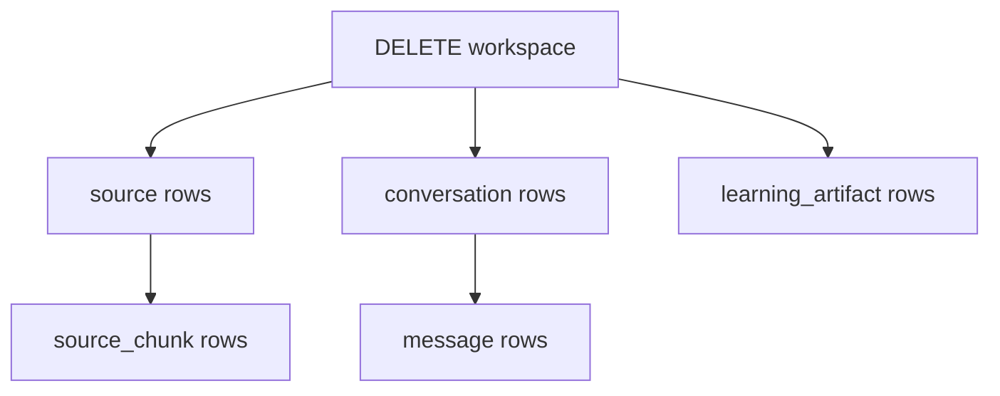

<details>
<summary>Diagram not rendering (e.g. in the GitHub mobile app)? View it as an image</summary>

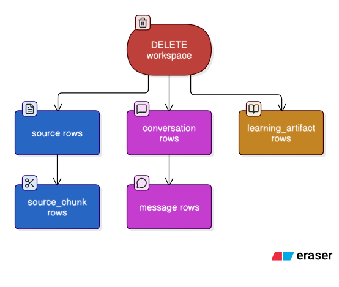

</details>

**Cascades do not reach external systems.** The services clean those up explicitly:

| Action             | What the service does besides the Postgres delete                                                                                           |
| ------------------ | ------------------------------------------------------------------------------------------------------------------------------------------- |
| Delete a source    | Sends `source/deleted` (cancels a running processing job), deletes its vectors from Pinecone, deletes its chunks                            |
| Delete a workspace | Sends `workspace/deleted` (cancels running source and artifact jobs), deletes the whole Pinecone namespace (best effort, logged on failure) |

PDF files stored on Cloudinary are not deleted.

---

## 5. Indexes and constraints

Primary keys are indexed automatically. Everything else:

| Table               | Index / constraint                                                 | Kind   | Serves                                                                        |
| ------------------- | ------------------------------------------------------------------ | ------ | ----------------------------------------------------------------------------- |
| `user`              | `user_email_key (email)`                                           | unique | Login by email; one account per email                                         |
| `session`           | `session_token_key (token)`                                        | unique | Looking up the session from the cookie on every request                       |
| `session`           | `session_userId_idx (userId)`                                      | index  | Listing/revoking a user's sessions                                            |
| `account`           | `account_userId_idx (userId)`                                      | index  | Finding a user's linked logins                                                |
| `verification`      | `verification_identifier_idx (identifier)`                         | index  | Finding a pending verification                                                |
| `workspace`         | `workspace_userId_idx (userId)`                                    | index  | `GET /api/workspaces`; the ownership check on every workspace route           |
| `source`            | `source_workspaceId_idx (workspaceId)`                             | index  | Listing a workspace's sources                                                 |
| `source`            | `source_workspaceId_type_idx (workspaceId, type)`                  | index  | `?type=` filter                                                               |
| `source`            | `source_workspaceId_status_idx (workspaceId, status)`              | index  | `?status=` filter; "READY sources" for chat/artifacts; "FAILED" for reprocess |
| `source_chunk`      | `source_chunk_sourceId_index_key (sourceId, index)`                | unique | Keeps chunk order unambiguous; ordered reads                                  |
| `source_chunk`      | `source_chunk_sourceId_idx (sourceId)`                             | index  | Reading/deleting a source's chunks                                            |
| `conversation`      | `conversation_workspaceId_idx (workspaceId)`                       | index  | Listing conversations                                                         |
| `conversation`      | `conversation_workspaceId_updatedAt_idx (workspaceId, updatedAt)`  | index  | Sidebar sorted by most recent activity                                        |
| `message`           | `message_conversationId_idx (conversationId)`                      | index  | Counting a conversation's messages                                            |
| `message`           | `message_conversationId_createdAt_idx (conversationId, createdAt)` | index  | History in order; "last N messages" for the model                             |
| `learning_artifact` | `learning_artifact_workspaceId_idx (workspaceId)`                  | index  | Listing artifacts                                                             |
| `learning_artifact` | `learning_artifact_workspaceId_type_idx (workspaceId, type)`       | index  | Filtering by artifact type                                                    |
| `learning_artifact` | `learning_artifact_workspaceId_status_idx (workspaceId, status)`   | index  | Filtering by generation status                                                |

The `?q=` source search uses `ILIKE` on `title` and `content`. There is no full-text index, so
it is a sequential scan within the workspace's rows. That is fine at notebook scale. Semantic
search happens in Pinecone, not Postgres.

---

## 6. Enums and status lifecycles

| Enum             | Values                                                                    | Used by                    |
| ---------------- | ------------------------------------------------------------------------- | -------------------------- |
| `SourceType`     | `PDF`, `WEBSITE`, `YOUTUBE`, `TEXT`, `MARKDOWN`                           | `source.type`              |
| `SourceStatus`   | `PENDING`, `PROCESSING`, `READY`, `FAILED`                                | `source.status`            |
| `MessageRole`    | `USER`, `ASSISTANT`                                                       | `message.role`             |
| `ArtifactType`   | `SUMMARY`, `TAKEAWAYS`, `FLASHCARDS`, `QUIZ`, `MINDMAP`, `REPORT`, `WIKI` | `learning_artifact.type`   |
| `ArtifactStatus` | `PENDING`, `PROCESSING`, `READY`, `FAILED`                                | `learning_artifact.status` |

Web search results saved as sources use type `WEBSITE` (with `metadata.importedFrom = "web-search"`).

### Source lifecycle

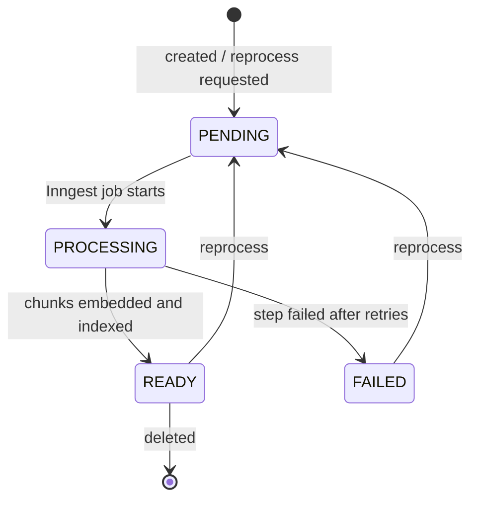

<details>
<summary>Diagram not rendering (e.g. in the GitHub mobile app)? View it as an image</summary>

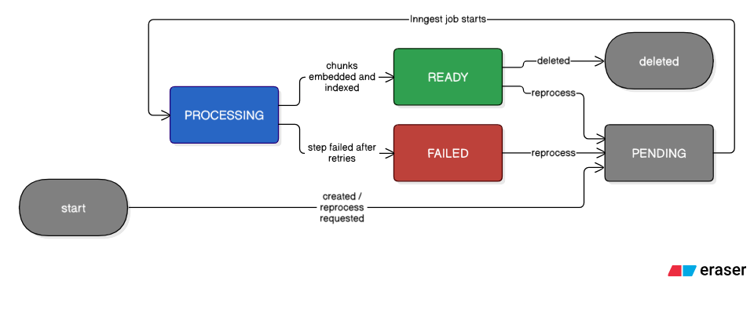

</details>

Only `READY` sources are used by chat retrieval and artifact generation.

### Artifact lifecycle

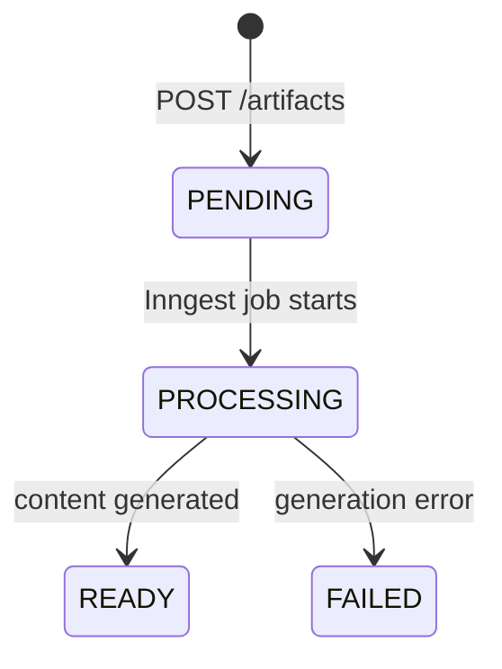

<details>
<summary>Diagram not rendering (e.g. in the GitHub mobile app)? View it as an image</summary>

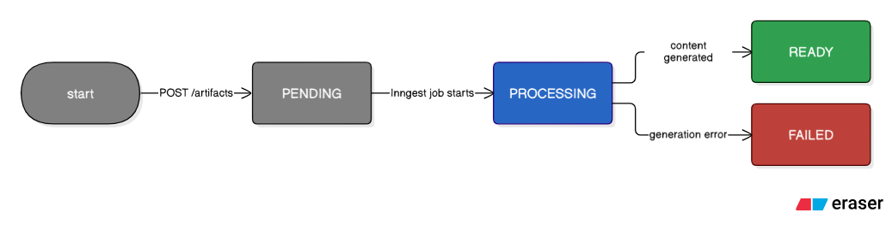

</details>

---

## 7. JSON columns

JSON columns hold data whose shape varies by type. TypeScript types for them live in the code.

### `source.metadata` (`SourceMetadata` in `source-processing.service.ts`)

```jsonc
{
    "fileUrl": "https://res.cloudinary.com/.../report.pdf", // PDF only
    "fileName": "report.pdf", // PDF only
    "fileSize": 482113, // bytes, PDF only
    "publicId": "grounded_brain_notebook_llm/pdfs/report.pdf", // Cloudinary id, PDF only
    "resourceType": "raw", // Cloudinary resource type
    "pageCount": 12, // PDF only
    "importedFrom": "https://example.com/article", // website URL, or "web-search"
    "sourceUrl": "https://...", // web-search imports
    "videoId": "aircAruvnKk", // YouTube only
    "chunkCount": 42, // set when READY
    "indexedAt": "2026-10-20T10:00:00.000Z", // set when READY
    "processingError": "No text could be extracted", // set when FAILED
}
```

### `message.citations` (assistant messages)

Only sources the answer actually cites (`[1]`, `[W2]`, ...) are stored:

```jsonc
[
    {
        "marker": 1, // the [1] in the answer text
        "sourceId": "cm...",
        "sourceTitle": "Photosynthesis",
        "sourceType": "TEXT",
        "chunkId": "cm...",
        "chunkIndex": 0,
        "page": 3, // PDFs only
        "excerpt": "first 280 chars of the chunk...",
        "score": 0.82, // cosine similarity
    },
    {
        "marker": 1, // the [W1] in the answer text
        "sourceType": "WEB",
        "sourceTitle": "Chlorophyll - Wikipedia",
        "url": "https://...",
        "excerpt": "first 280 chars of the result...",
    },
]
```

### `learning_artifact.content` (by `type`)

| Type         | Shape                                                                                                                                     |
| ------------ | ----------------------------------------------------------------------------------------------------------------------------------------- |
| `SUMMARY`    | `{ "markdown": "..." }`                                                                                                                   |
| `TAKEAWAYS`  | `{ "items": ["...", "..."] }` (3–20)                                                                                                      |
| `FLASHCARDS` | `{ "cards": [{ "front": "...", "back": "..." }] }` (3–30)                                                                                 |
| `QUIZ`       | `{ "questions": [{ "question": "...", "options": ["..."], "correctIndex": 0, "explanation": "..." }] }` (3–15, `correctIndex` is 0-based) |
| `MINDMAP`    | `{ "nodes": [{ "id": "...", "label": "..." }], "edges": [{ "id": "...", "source": "nodeId", "target": "nodeId" }] }`                      |
| `REPORT`     | `{ "markdown": "...", "sections": [{ "title": "...", "content": "..." }] }`                                                               |

### `learning_artifact.metadata`

`{ "generatedAt": "<ISO date>" }` when READY, or `{ "processingError": "..." }` when FAILED.

---

## 8. Data that lives outside Postgres

| Store          | What it holds                                          | Keyed by                                                                                 | Code                                      |
| -------------- | ------------------------------------------------------ | ---------------------------------------------------------------------------------------- | ----------------------------------------- |
| **Pinecone**   | One 1536-dimension embedding per `source_chunk`        | Index `PINECONE_INDEX`; **namespace = `workspaceId`**; **vector id = `source_chunk.id`** | `shared/ai/vector.repository.ts`          |
| **Mem0**       | Long-term facts about a user ("prefers short answers") | `user_id = user.id`; memory ids are Mem0 UUIDs                                           | `features/memory/memory.repository.ts`    |
| **Cloudinary** | Original uploaded PDF files                            | `source.metadata.publicId`                                                               | `features/source/ingestion/cloudinary.ts` |

Each Pinecone vector carries metadata so retrieval needs no Postgres lookup:

```jsonc
{
    "workspaceId": "...",
    "sourceId": "...",
    "chunkId": "...",
    "chunkIndex": 4,
    "sourceTitle": "Photosynthesis",
    "sourceType": "PDF",
    "text": "chunk text (max 35,000 chars)",
    "page": 3,
}
```

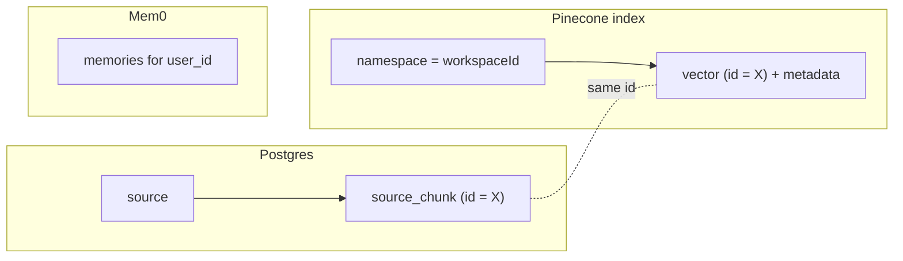

<details>
<summary>Diagram not rendering (e.g. in the GitHub mobile app)? View it as an image</summary>

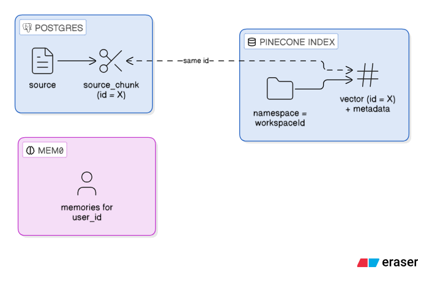

</details>

---

## 9. Model → table name mapping (`@@map`)

Prisma models are PascalCase; `@@map` gives the Postgres tables snake_case names.

| Prisma model       | Postgres table      | Schema file                              |
| ------------------ | ------------------- | ---------------------------------------- |
| `User`             | `user`              | `prisma/models/user.prisma`              |
| `Session`          | `session`           | `prisma/models/session.prisma`           |
| `Account`          | `account`           | `prisma/models/account.prisma`           |
| `Verification`     | `verification`      | `prisma/models/verification.prisma`      |
| `Workspace`        | `workspace`         | `prisma/models/workspace.prisma`         |
| `Source`           | `source`            | `prisma/models/source.prisma`            |
| `SourceChunk`      | `source_chunk`      | `prisma/models/source-chunk.prisma`      |
| `Conversation`     | `conversation`      | `prisma/models/conversation.prisma`      |
| `Message`          | `message`           | `prisma/models/message.prisma`           |
| `LearningArtifact` | `learning_artifact` | `prisma/models/learning-artifact.prisma` |

Column names are not mapped, so they stay camelCase in Postgres (`"workspaceId"`). Quote them in raw SQL.

In code you use the model name in camelCase: `prisma.learningArtifact.findMany(...)`.

---

## 10. Migrations and workflow

| Migration                               | Adds                                                             |
| --------------------------------------- | ---------------------------------------------------------------- |
| `20261019073138_init`                   | Better Auth tables: `user`, `session`, `account`, `verification` |
| `20261019081113_add_workspace`          | `workspace`                                                      |
| `20261019092019_add_sources`            | `SourceType`, `SourceStatus`, `source`                           |
| `20261019125202_add_source_chunks`      | `source_chunk`                                                   |
| `20261019130914_add_conversations`      | `MessageRole`, `conversation`, `message`                         |
| `20261019144059_add_learning_artifacts` | `ArtifactType`, `ArtifactStatus`, `learning_artifact`            |

### Changing the schema

1. Edit (or add) a file in `prisma/models/`. A new file is picked up automatically: `prisma7.config.ts`
   points Prisma at the whole `prisma/` folder and merges every `.prisma` file.
2. `npm run db:migrate -- --name describe_the_change` creates a migration and applies it locally.
3. `npm run db:generate` regenerates the client in `src/generated/prisma` (also runs on `npm run build`).
4. Commit the model change **and** the new migration folder.

| Command                     | What it does                                                         |
| --------------------------- | -------------------------------------------------------------------- |
| `npm run db:migrate`        | Create + apply a migration (development)                             |
| `npm run db:migrate:deploy` | Apply pending migrations without creating new ones (CI / production) |
| `npm run db:generate`       | Regenerate the Prisma client                                         |
| `npm run db:studio`         | Open Prisma Studio on http://localhost:5555                          |
| `npm run docker:reset`      | Drop the local database volume, recreate it and re-apply migrations  |

### How Prisma errors become API errors

Repositories don't catch Prisma errors; the global error handler maps them:

| Prisma code                                             | Meaning                               | API response              |
| ------------------------------------------------------- | ------------------------------------- | ------------------------- |
| `P2025`                                                 | Row to update/delete not found        | 404 `NOT_FOUND`           |
| `P2003`                                                 | Foreign key target no longer exists   | 404 `NOT_FOUND`           |
| `P2002`                                                 | Unique constraint violated            | 409 `CONFLICT`            |
| `P1001`, `P1002`, `P1017`, `P2024`, `ECONNREFUSED`, ... | Database unreachable / pool exhausted | 503 `SERVICE_UNAVAILABLE` |
